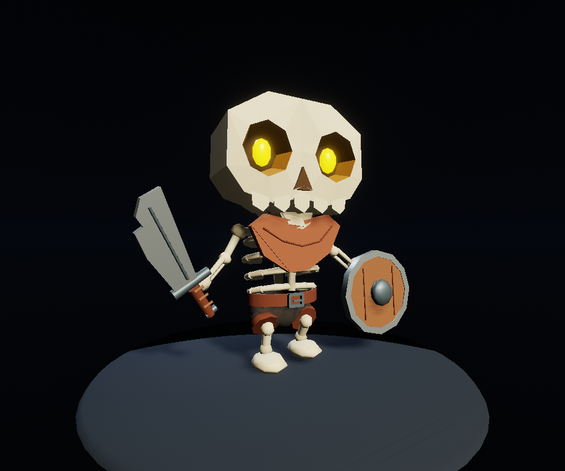

# Skeleton: геометрия, риг и ходьба через AdaScript

Эксперимент в ветке `codex/procedural-skeleton-study` по пользовательскому
референсу с подписью KayKit. Весь рецепт — геометрия, 23 сустава, правила весов
и ключи ходьбы — выполняется из одного `Generators/Skeleton-Rig.ada`.
Blender, облачная 3D-модель и отдельная Swift-программа авторства не требуются.
Сам языковой агент от этого не становится локальным.



## Как это работает без Swift Compiler на устройстве

```text
Агент → AdaScript → встроенный компилятор байткода + VM
      → заранее скомпилированный model builder → AdaAssets GLBWriter
      → GLB → native importer → SkeletalAnimationPlayer + GPU skinning
```

Компилятор байткода входит в приложение. Он не создаёт машинный код и не требует
JIT. Native builder и экспорт GLB тоже заранее входят в сборку Studio.
Агент не пишет и не компилирует Swift для каждого персонажа. На iPad не нужны
Python, SwiftPM, `swiftc`, shell или внешние процессы.

В bridge добавлены `joint`, `bind`, `weights`, `clip`, `rotationKey`,
`translationKey` и чтение имён/родителей/вершин исходных деталей. Скелет,
двухзвенный IK ног, правила скиннинга и фазы ходьбы задаёт **AdaScript**.
Нативная часть хранит данные, проверяет аргументы, запекает преобразования,
считает inverse bind matrices и собирает буферы. Правил именно этого персонажа
в ней нет.

В обновлённом приложении агент передаёт **полный текст** `Skeleton-Rig.ada`
в существующий `editor.model.generate` как `source`, с новым `destination`,
например `Assets/Models/Skeleton-v2.glb`. Внешние файлы рецепт не читает:
статическая геометрия включена в этот же текст.

Установленная здесь Studio собрана **до добавления этих функций**. Её runtime
уже импортирует и проигрывает новый GLB, но для выполнения рецепта через её MCP
нужна обновлённая сборка приложения. Полная пересборка Studio и запуск на
физическом iPad не выполнены. Проверка VM на Windows доказывает путь без
внешнего компилятора, а не готовность iPad-сборки.

## Результат

Стартовая сцена `Assets/Scenes/Walk.ascn` использует
`Assets/Models/Skeleton-AdaScript.glb`:

- 23 сустава, 11 материалов и 11 skinned mesh nodes.
- 7 348 вершин и 4 284 треугольника; исходные 137 мешей объединены по материалу.
- Настоящие `JOINTS_0` и `WEIGHTS_0`; 306 вершин имеют два ненулевых влияния.
  Костные детали и оружие привязаны жёстко; одежда и позвоночник смешивают веса.
- `Walk`: ходьба на месте, 1,2 секунды, 49 ключей на канал. IK вычисляется при
  авторстве; runtime играет обычный клип со сгибанием коленей, переносом стоп,
  покачиванием корпуса и движениями рук, головы и челюсти.
- `BindPose`: исходная поза для проверки привязки.

Открыть проект и нажать Play. Для исходной позы сменить `animation` в
`Model3DSource` с `Walk` на `BindPose`. Статическая версия сохранена в
`Showcase.ascn` / `Skeleton.glb`. Прежние `NativeRig/` и `Skeleton-Walk.glb`
оставлены для сравнения; новый рецепт их не использует.

## API рига

Фрагмент внутри `func build(model)`, после построения геометрии:

```text
var root = model.joint("Root", -1, 0, 0, 0);
var head = model.joint("Head", root, 0, 1, 0);
model.bind(headPart, head);
model.weights(clothPart, vertex, root, 0.3, head, 0.7);
var walk = model.clip("Walk");
model.rotationKey(walk, head, 0, 0, -5, 0);
model.rotationKey(walk, head, 0.6, 0, 5, 0);
model.rotationKey(walk, head, 1.2, 0, -5, 0);
```

ID детали и ID сустава — разные пространства. Позиции суставов и ключи локальны
относительно родителя; углы в градусах. У первого root родитель `-1`, остальные
родители создаются раньше детей. Сначала полностью построить геометрию, затем
риг: функции рига замораживают детали, имена и преобразования. Каждый меш
привязать через `bind`, после чего можно менять веса отдельных вершин.

Лимиты: 128 суставов, два влияния на вершину, 32 клипа, 16 384 ключа.
Каналы — перенос и вращение с LINEAR-интерполяцией; вращения хранятся
кватернионами. Rest rotations суставов, scale-ключи и редактирование импортированной
сетки пока не выставлены в этот API. Повтор клипа включает `Model3DSource`.
Действуют лимиты генератора: 64 KiB исходника, бюджет времени/шагов и геометрии.
Это явный риг известной модели; автоматического определения анатомии здесь нет.

## Проверка разработчиком

Рецепт, GLB и сцена включены в проект. Следующие команды — **проверка на
компьютере**, а не действия, нужные пользователю iPad. Из этой папки:

```powershell
python script_rig.py test --gravity D:/Development/AdaEngine/.build-tools/gravity-windows
python script_rig.py generate --gravity D:/Development/AdaEngine/.build-tools/gravity-windows
python check_rig.py --asset Assets/Models/Skeleton-AdaScript.glb --output Evidence/ScriptRig/buffer-check.json
```

Путь `--gravity` — локальная Windows-совместимая checkout зависимости; заменить
своим или задать `ADAENGINE_GRAVITY_PACKAGE_PATH`. `generate` составляет единый
`.ada` из `Generators/Skeleton.ada` и `Generators/SkeletonRigRecipe.ada`.
Геометрия задаётся `author_recipe.py`, риг и движение — `SkeletonRigRecipe.ada`.

Изолированный пакет `.build-tools/skeleton-script` использует реальные production
sources генераторов, compiler core, Gravity VM, Math, AdaAssets importer/exporter.
Для standalone-сборки используются узкий resource-scope адаптер без ECS asset
manager и DTO-части двух файлов AdaScripting. Это не полная сборка движка/Editor.
Первая сборка требует Swift и зависимости; готовый исполняемый файл — нет:

```powershell
python script_rig.py run --runtime-path "$env:LOCALAPPDATA/Programs/Ada Studio;C:/Windows/System32"
```

Команда проверяет отсутствие `swift` и `swiftc` в `PATH` уже собранного VM runner.
Studio в этом `PATH` предоставляет runtime DLL. Во время генерации VM не запускает
процессов; сам `.ada`-рецепт не читает и не пишет файлы.

Для нативного захвата открыть проект в полной Studio с `--mcp-port=2516`:

```powershell
python rig_capture.py --asset Assets/Models/Skeleton-AdaScript.glb --evidence Evidence/ScriptRig --live-only
```

Команда переключает Walk/BindPose, делает Build, снимает реальные кадры и Transform
суставов, затем возвращает Walk и запускает Play. Не редактировать ту же сцену
одновременно с захватом. Без параметров `rig_capture.py` воспроизводит прежний
Swift baseline и его 24 фиксированные фазы; для кодирования его GIF нужен Pillow.

## Приёмка

Windows; Swift 6.3.1 для разработки; полная установленная Ada Studio,
WebGPU / D3D12, RTX 4070 для импорта и воспроизведения.

| Проверка нового пути | Свидетельство |
| --- | --- |
| 17 Swift Testing tests, 4 suites: model, rig, voxel, sound/sprite | `Evidence/ScriptRig/script-tests.log` |
| Реальная VM → GLB → native importer, без доступных swift/swiftc; lint рецепта: 0 | `Evidence/ScriptRig/compiler-free-run.json` |
| Buffers, веса, bind pose, сохранение вершин и нормалей | `Evidence/ScriptRig/buffer-check.json` |
| Все каналы Walk/BindPose совпадают с прежним автором с точностью 0,000001 | `Evidence/ScriptRig/walk-comparison.json` |
| 23 сустава, skin, clips, import profile | `Evidence/ScriptRig/native-validation.json` |
| Build с отключённым SwiftPM | `Evidence/ScriptRig/build-output.json` |
| Строгая валидация проекта, lint: 0 | `Evidence/ScriptRig/project-validation.json` |
| Живой Walk: три разные позы бедра, кадры меняются, ошибок нет | `Evidence/ScriptRig/live-motion.json` |
| Завершённые GPU-кадры Walk и BindPose | `Evidence/ScriptRig/*.png` |

Ошибка сохранения геометрии и bind pose меньше 0,00001 м, нормали сохранены,
веса нормализованы, первый и последний ключи Walk совпадают. Предыдущие 19 тестов
плеера/экспорта и 24 GPU-фазы сохранены отдельно в `Evidence/Rig/`; его GIF
относится к Swift baseline. Developer build завершился успешно, хотя Windows
macro plugin напечатал нефатальную диагностику `DecodingError` (лог сохранён).

Пальцы, facial rig, ретаргетинг, физика ткани и полная проверка самопересечений
сюда не входят. Рендерер и шейдеры не менялись; полная GPU regression suite
и физический iPad не проверялись.
