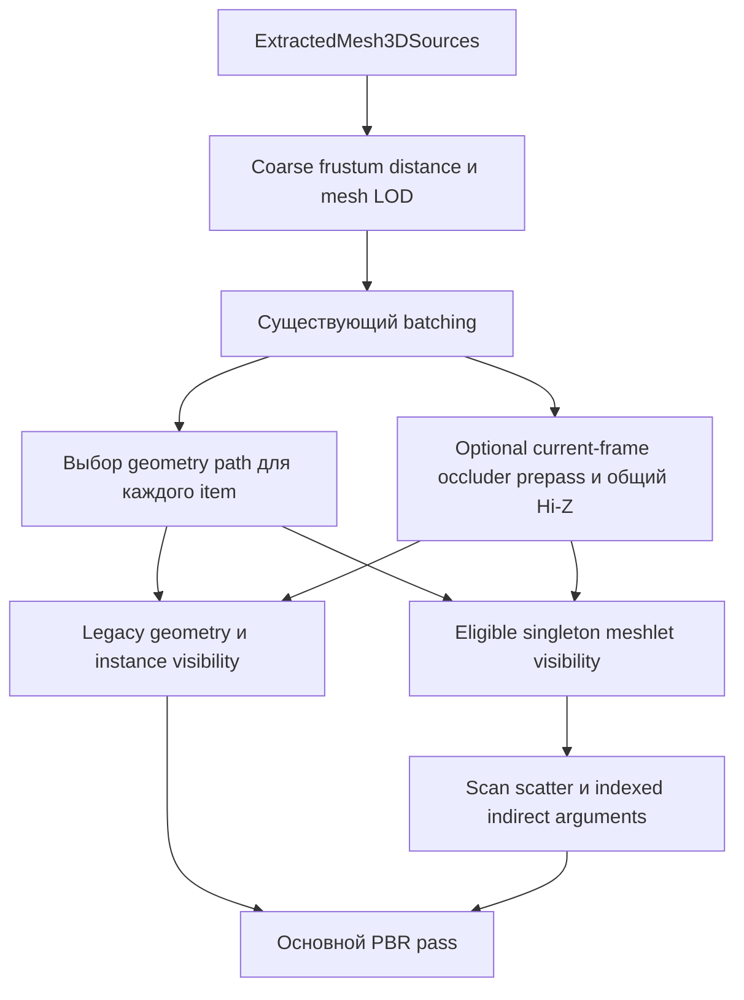

# ADR-0028: Мешлеты и переносимое отсечение кластеров

- **Status:** Experimental native frustum v1 implemented; расширенный rollout остаётся Proposed.
- **Date:** 2026-11-02.
- **Обновлено:** 2026-11-03.
- **Implementation:** CPU asset/reference и native WebGPU frustum path реализованы; Metal source path добавлен без проверки на Metal-устройстве.
- **База анализа:** checkout `a7f0ce13`; локальные изменения пользователя сохранены.
- **План подготовки и реализации:** [Meshlets preparation](../Plans/2026-11-02-MeshletsPreparation.md).
- **Подготовка P0:** [native baseline и аудит](../Performance/MeshletsP0-2026-11-02.md) реализованы; geometry-bound performance gate остаётся открыт.
- **Native v1:** [реализация, проверки и A/B](../Performance/MeshletsImplementation-2026-11-03.md). Измерения и границы проверки брать из отчёта.
- **Расширение LOD:** [адаптивные упрощённые родители и качество теней](../Performance/MeshletLODAndShadows-2026-11-03.md). Отдельный opt-in hierarchy sidecar, без streaming или mesh shaders; далее frustum v1 и исходный roadmap описаны исторически.
- **Связанные решения:** [ADR-0020](0020-gpu-visibility-and-animation-lod.md), [ADR-0027](0027-3d-rendering-pipeline-gap-roadmap.md).

## 1. Предлагаемое решение

Разбивать геометрию `Mesh.Part` на небольшие группы треугольников — мешлеты — и проверять видимость этих групп внутри уже выбранного mesh LOD. Первую версию строить на обычных vertex/fragment shaders, compute и indexed indirect draws для Metal и WebGPU. Аппаратные mesh shaders оставить отдельным последующим расширением.

Первая полезная область — большие статические непрозрачные модели, частично попадающие в кадр или закрытые другой геометрией. Для повторяющихся объектов сохранять существующий instancing. Мешлеты не означают автоматического ускорения: стоимость проверки, копирования индексов и дополнительных проходов должна окупиться уменьшением работы основного прохода.

В ADR-0027, Stage 7, meshlets/mesh shaders были отложены. Реализованный экспериментальный срез меняет это только для opt-in статической геометрии и проверенного native WebGPU пути. Он не означает готовность mesh shaders, Metal/browser acceptance или подтверждённое ускорение на всех сценах.

### Реализованный срез на 2026-11-03

- Optional immutable `MeshletGeometry` у `Mesh.Part`, CPU validation, cached aggregate bounds и identity поколения. Отсутствие данных или замена исходного buffer/count сохраняет legacy draw.
- Standalone C++ adapter `Tools/Meshlets/MeshletScan.cpp` использует `meshopt_buildMeshletsScan` из meshoptimizer 1.3, commit `9e1f07b159d3cb777f1c67ed31fc11fd117986f4`, с pinned SHA-256 и MIT license. SwiftPM/runtime/WASM graph не получает builder dependency.
- `.gltf.meshlets` / `.glb.meshlets` хранит непрерывные диапазоны неизменённой исходной triangle sequence; importer проверяет digest и bounds. Геометрия не упрощается. Подробнее: [формат и инструмент](../../Tools/Meshlets/README.md), [receipts и профили](../../Evidence/Meshlets/Preparation-2026-11-03).
- Режимы `disabled`, `cpuReference`, `gpu`; coarse visibility/LOD и batching выполняются раньше eligibility. Native GPU использует три пакетных compute pass: classification/local prefix, scan сумм блоков по draw, scatter и indexed indirect. Fully-visible part использует cached aggregate bounds и исходный draw без compaction.
- `DebugView3D.meshlets` / «Карта мешлетов» показывает стабильные цвета реальных кластеров. Это карта partition, а не GPU visibility: ненужный compute отключён; expanded vertex cache ограничен 512 MiB, unsupported/budget-limited поверхности серые.
- Shadows, motion/contact и fallback сохраняют source buffers и mappings. Meshlet Hi-Z, cone, spatial reorder, browser delivery и Metal hardware acceptance **остаются открыты**. При legacy GPU occlusion production meshlet path выбирает legacy fallback; shared meshlet Hi-Z пока нет.

Остальные разделы фиксируют целевой дизайн. Пункты о shared Hi-Z, cone/sphere, расширенном export и platform acceptance описывают будущую работу, если явно не отмечены как реализованные выше.

## 2. Что уже есть в AdaEngine

| Точка интеграции | Проверенное состояние | Следствие для дизайна |
| --- | --- | --- |
| [`Mesh.swift`](../../Sources/AdaRender/Mesh/Mesh.swift) | `Mesh.Model` содержит `Mesh.Part`; part хранит material index, topology, descriptor, vertex/index buffers и optional morph targets | Кластеры принадлежат part; геометрию разных материалов не смешиваем |
| [`MeshDescriptor.swift`](../../Sources/AdaRender/Mesh/MeshDescriptor.swift) | Есть CPU positions и `indicies: [UInt32]`; поддерживаются разные topology | Builder получает проверенный triangle list; остальные topology используют исходный путь |
| [`ModelAsset3D.swift`](../../Sources/AdaScene/3D/ModelAsset3D.swift) | glTF primitives преобразуются в descriptors; fan разворачивается в list, strip остаётся strip | Sidecar сопоставляется с результатом преобразования; v1 принимает triangle lists, strips используют fallback |
| [`VisibleMesh3DLists.swift`](../../Sources/AdaCorePipelines/CorePipelines/VisibleMesh3DLists.swift) | CPU frustum/distance culling, mesh LOD, упаковка экземпляров, batching; списки по view/pass | Сохраняем coarse culling и LOD перед meshlet culling |
| [`GPUVisibility3D.swift`](../../Sources/AdaCorePipelines/CorePipelines/GPUVisibility3D.swift) | Текущий opaque/mask depth prepass, затем GPU Hi-Z и instance compaction | Повторно используем правила консервативной видимости; Hi-Z не обязателен для frustum-only meshlets |
| [`GPUVisibility.swift`](../../Sources/AdaRender/Misc/GPUVisibility.swift) | Backend-neutral processor и `IndexedIndirectArguments` из пяти 32-битных полей | Расширяем существующий indirect-контракт, не создаём новый формат draw arguments |
| [`RenderBackend.swift`](../../Sources/AdaRender/Backends/RenderBackend.swift) | `RenderDevice.createGPUVisibilityProcessor()` optional; общедоступного compute encoder в текущем `CommandBuffer` нет | Узкий optional meshlet processor вместо обязательного общего compute API |
| [`Model3DPlugin.swift`](../../Sources/AdaScene/3D/Model3DPlugin.swift) | `Model3DDrawPass` выбирает buffers; motion/contact обходят существующий indirect-путь | Интеграция требует явного выбора geometry для каждого прохода |
| [`WGPURenderCommandEncoder.swift`](../../Sources/AdaRender/Backends/WebGPU/Misc/WGPURenderCommandEncoder.swift) | Native indirect draw и отдельный WASM JS bridge | Нативный тест не заменяет проверку экспортированного браузерного проекта |
| [`Render3DPerformanceBenchmarkTests.swift`](../../Tests/AdaEngineTests/Render3DPerformanceBenchmarkTests.swift) | Есть benchmark harness; GPU pass timestamps — на Metal, WebGPU сейчас даёт wall time | Числа GPU time, CPU time и frame time публикуем раздельно |

Runtime теперь реализован в `MeshletGeometry`/`MeshletSidecar`, `Meshlet3D`, `MeshletMap3D` и backend processors. `Mesh` asset coding не используется для sidecar: это отдельный проверяемый derived resource.

## 3. Границы первой версии

**Входит:** offline-подготовка импортированных triangle-list моделей, immutable meshlet data, CPU reference, GPU frustum culling и compacted index buffer для singleton batches, Metal/native WebGPU, безопасный fallback, диагностика и A/B. Hi-Z и cone culling добавляются отдельными проверяемыми срезами после frustum-only пути. Браузер получает собственный этап проверки перед включением.

**Остаётся на текущем renderer:** instanced batches с несколькими экземплярами, BLEND и MASK, skinned/morphed parts, Shader Graph, vertex displacement и неизвестные vertex-деформации, динамически изменяемая геометрия. V1 поддерживает только стандартный opaque PBR без изменения покрытия за пределами исходных треугольников; в частности, parallax depth/другие изменения глубины требуют отдельной проверки и пока исключены. Eligibility определяется на уровне конкретного draw, а не только файла модели.

**Позже:** native Metal mesh/object shaders, расширение instancing, независимое meshlet-отсечение теней, консервативные animated bounds, runtime procedural builders, compression, cluster hierarchy, автоматическая LOD simplification, streaming и виртуализированная геометрия. Плоское разбиение на мешлеты не является Nanite и не изменяет collision, navigation или ray-tracing geometry.

## 4. Владение и зависимости

| Модуль | Ответственность |
| --- | --- |
| `AdaRender` | CPU meshlet schema и validation, optional data у `Mesh.Part`, GPU layout, processor protocol и backend implementations |
| `AdaCorePipelines` | Settings, eligibility после coarse visibility/LOD/batching, per-view/pass state, orchestration и counters |
| `AdaScene` | Привязка sidecar при загрузке `ModelAsset3D`, передача optional meshlet data, выбор исходной/compacted geometry в `Model3DDrawPass` |
| `AdaAssets` | Использование существующих asset paths/cache/resource lookup; формат glTF не обязан знать о renderer clusters |
| `Tools/Meshlets` и `script/prepare_meshlets.py` | Реализованный standalone native adapter и запись sidecar; вне SwiftPM/runtime graph |
| Native build tool / Editor | Запуск preprocessing и доставка sidecar с asset bundle; не делает `AdaScene` зависимым от offline builder |

Текущая граница не требует нового SwiftPM processing target: offline tool собирается отдельно без GPU device. Python preparation воспроизводит float32 и fan-to-list контракт импортера; strips остаются fallback, sparse accessors явно отклоняются. Расширенная нормализация требует тестов эквивалентности, а не молча другого преобразования.

## 5. Подготовка ассетов

### 5.1. Builder

Реализован adapter через C API meshoptimizer 1.3, с закреплёнными commit/file hashes и MIT license. `script/build_meshlet_tool.py` собирает standalone инструмент в `.build-tools`; existing third-party targets не меняются. Windows clang++ проверен; macOS/Linux остаются отдельным gate. Прямого Swift C++ interop в runtime нет.

Текущий профиль — **64 вершины / 96 треугольников**. Сравнение 64/64, 64/96 и 64/126 по utilization, duplicated references и размерам сохранено в [preparation evidence](../../Evidence/Meshlets/Preparation-2026-11-03/profile-comparison.json). Это эксперимент на PT LOD, не доказанный аппаратный оптимум; bounds-tightness и renderer A/B — отдельные измерения. [meshoptimizer: mesh shading](https://meshoptimizer.org/#mesh-shading)

Базовый профиль сохраняет порядок primitives: последовательный `meshopt_buildMeshletsScan`, без последующей перестановки triangles. Каждый кластер покрывает непрерывный участок исходного triangle list. Это важно для coplanar equal-depth surfaces, где произвольная перестановка может изменить победителя depth test даже у opaque материала. Пространственный `meshopt_buildMeshlets` проверяется отдельно: разрешён только при явном import option `allowPrimitiveReordering`, записанном в digest/profile; начальный `coneWeight = 0`. Такой профиль может дать более тесные bounds, но требует собственной проверки all-visible pixels и согласия asset pipeline на изменение primitive order.

Порядок обработки:

1. Получить тот же нормализованный triangle list, vertex order и part identity, которые использует runtime importer.
2. Проверить topology, кратность числа индексов трём, диапазоны, конечность positions, размеры и переполнения.
3. Разбивать каждый part и каждый уже существующий LOD независимо; не объединять вершины по позиции через UV/normal/tangent seams.
4. Сохранить каждое исходное ориентированное вхождение треугольника ровно один раз, включая дубликаты и degenerates. Degenerates не участвуют в cone fitting; отсутствие пригодных normals отключает cone. Если выбранный builder исключает такие треугольники, adapter должен сохранить их отдельными bounds-only кластерами либо отклонить meshlet sidecar целиком.
5. Для базового профиля проверить исходную последовательность треугольников после flatten кластеров; для reorder-профиля — multiset и явное разрешение import option. Вычислить консервативные bounds, trim временных arrays, сериализовать schema и hash.

Builder детерминирован для закреплённой версии/профиля и одинакового нормализованного входа. Совпадение байтов между разными CPU/toolchains не предполагается без проверки: версии builder/schema входят в ключ кэша, correctness опирается на triangle coverage и bounds.

### 5.2. CPU schema и sidecar

Реализованный `MeshletGeometry` — immutable `Sendable` value с cluster ranges/local AABB, cached aggregate AABB, UUID поколения и неизменёнными global `UInt32` indices с copy-on-write sharing. `Mesh.Part.meshlets` optional, по умолчанию `nil`; существующие initializers и геометрия сохраняются. Local remap/triangle stream проверяется внутри native builder, но не дублируется в runtime sidecar.

Текущий descriptor содержит offsets/counts и local AABB. Sphere/cone — будущие данные. Кластер наследует material/vertex layout part. Native adapter реконструирует каждый local index и отклоняет потерю или перестановку source triangles, включая degenerates; invalid output не записывается как готовый sidecar.

Sidecar `<asset-name>.meshlets` имеет 24-byte header `ADAMSHL1`/schema/profile/count, 28-byte part records и 32-byte cluster records. Числа little-endian; ranges, integer conversions и decoded size проверяются до выделения памяти. Потолок — 64 MiB / 65 536 part records. Это не raw dump Swift struct и не зависит от `MemoryLayout<Vector3>`. Builder provenance и source/dependency SHA-256 находятся в соседнем JSON receipt; geometry fingerprint — в part record.

Runtime fingerprint — FNV-1a 64 над float32 positions и нормализованными UInt32 indices/counts; это cache fingerprint, не security hash. Receipt отдельно фиксирует SHA-256 glTF/GLB и external buffers. Runtime повторно проверяет bounds и полное покрытие актуальной source sequence. Material/deformation проверяются eligibility; timestamp и один URL не служат identity данных.

В native v1 sidecar находится рядом с исходным model URL и загружается `ModelAsset3D` при импорте; absolute cache path не сериализуется в сцену. Missing/stale/corrupt/unsupported sidecar оставляет исходный mesh с диагностикой. Raw runtime import не запускает C++ builder. Native lookup проверен на реальном temporary glTF; расширенный hot reload/export/browser delivery остаётся отдельным gate.

Для процедурного `Mesh.generate` поведение сохраняется: без явно предоставленных подготовленных данных meshlets отсутствуют. Не строить их при первом draw или синхронно в render loop.

## 6. GPU-представление и память

CPU, disk и GPU layouts — разные контракты. Реализованный descriptor имеет 64 байта: `uint4` range, `float4` AABB minimum, `float4` AABB maximum, `uint4` reserved. CPU/GPU ABI проверяется отдельно от disk format. Cone/sphere остаются будущими отдельными buffers, без скрытой смены stride v1.

В реализованном scan-профиле cluster order уже совпадает с source triangle order: CPU indices не переставляются и не дублируются на диске. Backend загружает storage-readable source indices/descriptors один раз на generation. Исходные buffers остаются для fallback и других проходов. Отдельный reordered stream понадобится только будущему spatial profile.

На каждую активную view выделять ring ресурсов по `maxFramesInFlight`: meshlet visibility flags, prefix offsets, compacted index buffer, indirect arguments и optional diagnostic counters. Static geometry buffers разделяются между views и экземплярами; visibility/output никогда не разделяются между камерами.

Верхняя граница compacted output для выбранных draws: `sum(sourceIndexCount) * 4` байт; плюс scan scratch, descriptor/input buffers и arguments. Сумма считается checked arithmetic до encode. Ring умножает transient budget на число in-flight slots; дополнительные views также входят в общий budget устройства.

Лимиты ограничиваются одновременно настройкой движка, `maxBufferSize`, storage binding limits и dispatch limits реального устройства. Стартовый budget задаётся по результатам P0/P1; 128 MiB в существующем WebGPU processor — его текущий лимит, а не право нового кода игнорировать device limits. При превышении bounds/budget выбираем исходный draw **до** compute, без попытки частично отрисовать модель.

На Metal output оборачивается в backend-native `IndexBuffer`; на WebGPU нужен buffer с `STORAGE | INDEX` и arguments с `STORAGE | INDIRECT`, плюс только необходимые transfer usages. Текущий общий `createIndexBuffer` не гарантирует compute-write usage, поэтому allocation находится внутри processor. Raw native handle не выходит в `AdaCorePipelines`.

## 7. Контракт исполнения

### 7.1. Режимы

Предлагаемое additive поле `MeshVisibilitySettings3D.meshlets`:

| Режим | Поведение |
| --- | --- |
| `disabled` | Текущий renderer; значение для старых сцен и default v1 |
| `cpuReference` | Реализованный CPU frustum reference и coalesced indexed ranges; диагностический режим |
| `gpu` | GPU processor для eligible draws, обычный путь для остальных |

Cone и meshlet Hi-Z в native v1 отсутствуют; отдельные настройки для них — будущий этап. Legacy Hi-Z не включается автоматически вместе с `gpu`; его явное включение сейчас выбирает legacy fallback. Старые сцены decode в `disabled`. `auto` не вводится до измеренного критерия выбора.

### 7.2. CPU reference

Реализованный CPU reference после coarse culling/LOD/batching отбирает eligible singleton items (`batchRange.count == 1`), проверяет local AABB по frustum и объединяет соседние видимые source ranges. Cone отсутствует. Threshold для fallback при большом числе ranges пока не реализован и должен обосновываться benchmark; reference остаётся диагностическим режимом.

CPU reference служит oracle для topology/bounds/frustum и GPU compaction, но не oracle Hi-Z без отдельной CPU-модели того же depth pyramid. Рост draw calls в reference ожидаем и не выдаётся за production-ускорение.

### 7.3. Переносимый GPU-путь

V1 обрабатывает **только singleton batches после существующего batching**. Нельзя предварительно разбить instanced batch на одиночные draws ради eligibility. Обычные instanced items сохраняют текущие geometry и GPUVisibilityProcessor.

На eligible part один reserved output segment и один indirect draw, независимо от числа мешлетов:

1. Первый пакетный compute pass классифицирует meshlets по frustum и выполняет workgroup-local prefix scan; cone/Hi-Z ещё отсутствуют.
2. Второй пакетный pass сканирует суммы блоков по каждому draw и вычисляет итоговый `indexCount`. Порядок meshlet ID детерминирован, unordered atomic append не используется.
3. Третий пакетный pass scatter копирует global indices по local/block offsets в ограниченный segment. Число compute pass не растёт с числом singleton draws.
4. Finalize пишет `IndexedIndirectArguments(indexCount: total, instanceCount: 1, firstIndex: segmentStart, baseVertex: 0, firstInstance: 0)`. Полностью невидимый part получает `indexCount = 0`; arguments переписываются каждый кадр.
5. Основной raster pass использует исходные vertex buffers/material shaders и новый index buffer. Instance data привязывается к исходному singleton через offset slot 3; optional instance compaction не должна менять эту адресацию.

Command count известен CPU и равен числу выбранных coarse draws. GPU не возвращает draw count на CPU; multi-draw/count extensions, vertex pulling и bindless materials для v1 не требуются. Максимальная output capacity доказана исходным количеством индексов, поэтому scan/scatter не могут легально выйти за reserved segment.

Результат processor содержит typed index buffer, arguments, per-item offsets и статус encode. Для каждого view/pass/frame хранится geometry override; исходный `Mesh.Part` не мутирует. Отсутствие результата означает исходный draw, а не пустой draw. Если indirect encoding не поддержан, вместе восстанавливаются исходные index buffer, index count и instance binding: нельзя вызвать прямой draw исходного count поверх compacted buffer.

WebGPU требует `firstInstance = 0`, если optional feature `indirect-first-instance` не включена; выбираем ноль без зависимости от этой feature. Между compute-write и raster-read заканчиваем compute pass; корректные buffer usages и transitions обязательны. [WebGPU drawIndexedIndirect](https://www.w3.org/TR/webgpu/#dom-gpurendercommandsmixin-drawindexedindirect)

### 7.4. Совместная работа с текущим GPU visibility

**Текущий native v1:** при `gpuOcclusion == true` production meshlet path выбирает `legacyOcclusion` fallback. Meshlet Hi-Z и shared pyramid не реализованы; карта partition работает отдельно от visibility. Следующая схема — целевой P5 дизайн, не описание уже выполненного shared-depth прохода.

В `gpuOcclusion == false` meshlets выполняют frustum/cone culling без depth prepass. В `gpuOcclusion == true` orchestration делит items на disjoint subsets: eligible singleton meshlet draws и остальные legacy draws. Нельзя независимо переписать общий `Active3DInstanceBuffers.instances` и затем использовать старые singleton offsets.

Предлагается сохранить input instance buffer для meshlet subset; legacy output compaction получает отдельный binding/selection. Сначала API geometry override должен научиться выбирать источник instances на item. Оба пути используют один текущий occluder prepass и одну pyramid на view, если это обосновано запросами; второй полный depth prepass/pyramid запрещён. Извлечение общего Hi-Z preparation из существующих processors — prerequisite отдельного среза с регрессиями ADR-0020.

## 8. Консервативная видимость

- **Frustum:** affine AABB transform через absolute linear matrix, как в `MeshVisibility3DMath.transformed`; учитывает nonuniform scale и shear. При NaN/Inf или невалидной геометрии sidecar отклоняется; при недостоверном instance transform meshlet rejection отключается, без обещания корректной картинки для самого невалидного transform.
- **Sphere:** если понадобится, world radius должен использовать доказанную верхнюю оценку растяжения linear transform; максимум длин basis vectors не является общей оценкой при shear. V1 frustum/Hi-Z опирается на AABB.
- **Cone:** v1 выключен. Последующий этап использует documented bounds/cone convention meshoptimizer, включая apex и angular extent. Сначала разрешены только single-sided стандартные материалы, положительный determinant и rigid/uniform-positive scale transforms; reflected, nonuniform, shear, singular transforms и degenerate cones сохраняют frustum-only path. Orthographic projection требует своего корректного направления взгляда; до тестов cone для неё выключен.
- **Force visible:** сохраняет существующий смысл отключения visibility rejection; такой item идёт обычным путём целиком.
- **Hi-Z:** стандартная текущая depth convention `[0, 1]`, near 0/far 1, max-depth pyramid; reject только когда ближайшая глубина bounds строго дальше консервативного максимума плюс bias. Reverse-Z требует другого reduction/test и не включается неявно.
- **Projected bounds:** near-plane intersection, `w <= 0`, camera inside bounds, невалидная проекция или невозможность доказать occlusion означают keep. Прямоугольник расширяется с учётом raster/jitter precision, выбор mip покрывает весь rect, включая odd-size края. Depth prepass и тест используют согласованную текущую camera projection.
- **Hi-Z source:** полная исходная eligible opaque geometry и текущие допустимые legacy occluders; main-camera visibility не используется для выкидывания shadow casters. Прозрачные surfaces не становятся сплошными occluders.

Meshlet Hi-Z не добавляет previous-frame depth: движение камеры/объекта, teleport и удаление стены проверяются по текущему кадру. Полная геометрия в prepass означает, что экономится работа main pass, но не весь vertex workload кадра; это учитывается в benchmark.

## 9. Остальные проходы и жизненный цикл

В первой версии directional/local shadows, motion vectors и contact depth используют исходные part buffers и исходный instance mapping. Маски видимости основной камеры им не передаются. Самостоятельное meshlet-отсечение shadow faces — отдельный этап, включая shadow cache digests и light-space bounds. Picking, physics, navigation, baking и ray tracing продолжают видеть исходный mesh.

Motion/contact correctness для основной камеры проверяется отдельными golden/temporal tests; прежняя геометрия должна давать те же покрытия и transforms. Geometry overrides активны только при encode соответствующего main pass и очищаются до следующего view/pass. Изменение LOD выбирает meshlet data соответствующего LOD и не переносит IDs/visibility предыдущего уровня.

Offline CPU builder сейчас запускается отдельным CLI над source files без `World`/UI/GPU state. Будущий Editor wrapper должен использовать structured task над immutable snapshot. GPU upload/encode выполняются в существующем backend synchronization context. Shared handles требуют lock/lifetime обоснования.

Cache key GPU geometry включает asset generation и render device identity. Reload/reimport заменяет source и sidecar одной generation; старые GPU buffers удерживаются до завершения команд. Ring slots переиспользуются только после GPU completion; один лишь modulo frame counter не доказывает безопасность. В P0 проверить существующий submission contract и при необходимости добавить completion-token reuse, не копировать непроверенное предположение из соседнего processor.

Resize пересоздаёт только view-sized Hi-Z, не static clusters; закрытие камеры освобождает view state после завершения GPU работ. Смена устройства/потеря ресурса инвалидирует соответствующий GPU cache. Недостаток ресурсов сохраняет исходный renderer с reason counter; рендер-поток не ждёт фоновой подготовки и не делает синхронный readback.

## 10. Capabilities и расширение mesh shaders

Реализованный `RenderDevice.createMeshletVisibilityProcessor()` optional, с default `nil` для сторонних conformers. Protocol принимает validated geometry/source buffer, transform, projection и command buffer; возвращает typed output indices/arguments либо `nil` для fallback. Depth context и расширенные failure statuses — будущие дополнения. Общий GPUVisibilityProcessor независим.

| Backend | V1 | Условия включения |
| --- | --- | --- |
| Metal | Source implementation: compute + compacted indices + indexed indirect | Hardware compilation/pixels/timing ещё не проверены; acceptance gate открыт |
| Native WebGPU | Реализован WGSL frustum/scan/scatter + storage/index output + indexed indirect | Windows/D3D12 проверяется real-GPU tests; limits/fallback и A/B — в implementation report |
| Browser WebGPU | Тот же алгоритм, отдельная интеграция Swan/WASM | Export/build/runtime smoke на выбранном браузере; до проверки fallback |
| Headless / прочие unsupported configurations | CPU data tests и обычный renderer | Processor возвращает unsupported; наличие GPU не симулируется |

В текущем стандартном WebGPU API нет mesh/object shader stages, поэтому переносимый путь проектируется через compute и indexed draws. [WebGPU render pipelines](https://www.w3.org/TR/webgpu/#render-pipelines)

На Metal mesh shading и indirect mesh submission — разные capabilities. В актуальной таблице Apple mesh shading указан начиная с Apple7, indirect mesh arguments/ICB mesh draws — с Apple9; нельзя выводить второе из первого. Будущий native путь проверяет family, OS/API availability и pipeline limits отдельно; поддержка только direct mesh draw тоже полезна. [Metal Feature Set Tables](https://developer.apple.com/metal/capabilities/)

MSL mesh/object shaders потребуют отдельного pipeline descriptor, shader stages/reflection и raster-output совместимости с PBR/motion/shadows. Текущий shader compiler не получает fictitious mesh stage ради одной реализации. Это следующий ADR/расширение после измерений portable v1.

## 11. Диагностика и критерии принятия

Добавить per-view counters: eligible/fallback items с причинами, candidate/visible/rejected meshlets, source/submitted triangles, indirect draws, CPU ranges, persistent/transient bytes и ring peak. Отдельно показывать frustum/cone/occlusion rejection. GPU counters читать асинхронно только в debug/benchmark; normal frames не ждут их. CPU-known estimates и фактические GPU counts подписывать раздельно, чтобы не выдать candidate count за submitted triangles.

Debug views: cluster ID colors, AABB overlay, eligible/fallback reason, selected LOD и видимость. Цвет от стабильного local meshlet ID; overlay не изменяет production visibility. Вывод причин нужен и при частичной поддержке ассета.

### Correctness

- CPU builder: исходная triangle sequence для базового профиля; multiset с winding/multiplicity для reorder-профиля; seams, coplanar equal-depth surfaces, non-indexed input после нормализации, empty/tiny/degenerate/invalid inputs и каждый LOD.
- Bounds: все referenced positions внутри AABB/sphere, NaN/Inf rejection, conservative frustum при affine transforms.
- File/GPU ABI: version/endian/ranges, corrupted/truncated sidecars, stale dependencies, Swift/MSL/WGSL offsets и indirect stride 20 байт.
- Compute: GPU output indices/arguments против CPU reference; visible/none/all, scan через несколько workgroups, multiple segments/views, ring reuse, growth и forced allocation/limit fallback. Readback допустим в этих тестах.
- Pixels: исходный mesh против all-visible cluster path, затем frustum/cone/Hi-Z; разные материалы/UV seams, orthographic/perspective, reflected/nonuniform/shear transforms, LOD switch, camera cuts, occluder removal и near plane.
- Regression: instancing и existing GPU Hi-Z, independent shadows, motion/contact, TAA/temporal upscale, Shader Graph, MASK/BLEND, skin/morph и force-visible действительно проходят соответствующий fallback.
- Все новые package tests — Swift Testing; GPU suites вложены в `Render3DGPUTests` и сериализованы. Старые golden references не перезаписываются ради прохождения meshlet tests.

### Performance

Сравнивать четыре режима: legacy без Hi-Z; legacy с текущим Hi-Z; meshlets frustum-only; meshlets с shared current-frame Hi-Z. Cone on/off измерять отдельно. Сцены: один большой частично видимый mesh; закрытый интерьер; открытый all-visible mesh; много маленьких частей; тысячи повторяющихся экземпляров; две камеры.

Для каждого режима одинаковые camera paths, LOD, resolution/materials/postprocess, shader warmup и минимум три чередующиеся A/B пары. Собирать sustained frame median/p95, CPU list preparation/encode, Metal GPU pass timings, память и index bandwidth estimates. В будущем Hi-Z cost включается в итог. WebGPU wall time не называть GPU milliseconds; debug readback/overlays во время timing выключены. Начальные native frustum-only результаты — в [implementation report](../Performance/MeshletsImplementation-2026-11-03.md); они не закрывают автоматически следующие gates. [Методика](0027-3d-rendering-pipeline-gap-roadmap.md#performance-pass-1-2026-10-17).

Предлагаемый gate для рекомендации `gpu` на конкретном классе устройств: correctness без потерь геометрии; не менее 10% выигрыша median frame time на целевой большой модели/интерьере с повторяемостью выше шума; не более 3% регрессии median и 5% p95 на контрольных all-visible/instanced сценах, с заранее зафиксированным memory budget. Это критерии будущего эксперимента, а не уже полученные результаты. Если шум больше границы, результат inconclusive и эксперимент повторяется.

Снижение triangles/draw count без выигрыша frame time не проходит gate. Если compaction bandwidth или depth prepass съедают пользу, оставить feature opt-in, сузить eligibility по измеренному порогу либо перейти к исследованию native mesh shaders; не включать default по факту завершения кода.

## 12. Рассмотренные альтернативы

| Вариант | Оценка |
| --- | --- |
| Сразу Metal mesh shaders | Перспективно для устранения compacted-index traffic, но требует нового shader/pipeline контракта и не даёт WebGPU parity |
| По draw call на каждый meshlet | Простой prototype, но CPU/driver submission растёт с числом кластеров; только reference/debug |
| GPU indirect command на каждый meshlet | Не убирает фиксированную CPU encode нагрузку без дополнительных submission возможностей; v1 оставляет один command на исходный singleton item |
| Разбить все instanced batches по экземплярам | Уничтожает существующий batching и многократно увеличивает output память; исключено |
| Vertex pulling с global instance/meshlet IDs | Может масштабировать instancing, но меняет vertex input и material shaders; следующий эксперимент |
| Только CPU meshlet culling | Хороший oracle и дешёвое исследование, но не обещает выигрыш при большом числе ranges |
| Сразу hierarchy/streaming/cluster LOD | Другой проект с asset residency и simplification; не нужен для первой проверки полезности |

## 13. Решения, закрываемые подготовкой

1. P0: какая сцена действительно geometry-bound и какая доля singleton geometry остаётся после batching?
2. P1: закреплённая версия meshoptimizer, сборка native tool, точный format/digest, политика primitive order и доставка sidecar.
3. P2: measured размеры кластеров, persistent/transient budget и minimum eligible geometry size.
4. P3–P4: typed geometry override, per-item instance source и доказанный ring completion contract.
5. P5–P6: выгоден ли portable path на Metal/WebGPU и нужен ли native mesh-shader prototype?

Эти вопросы не блокируют CPU asset foundation; включение GPU path зависит от соответствующего gate. До измерений default остаётся `disabled`.
