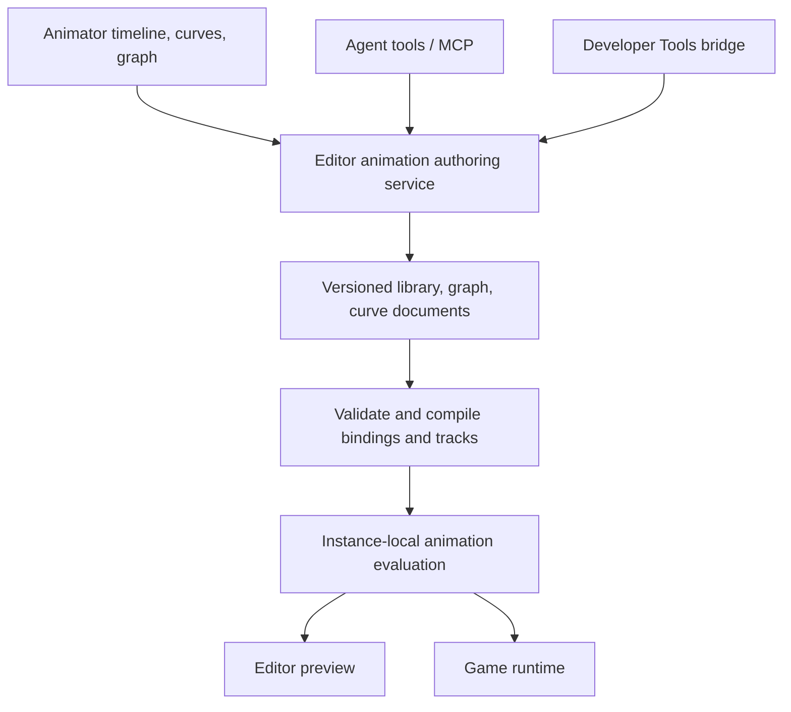

# Animation Authoring, Shared Tools API, and IK Preparation

Status: **Accepted design; implementation and validation in progress.**

Amendment approval: explicit human approval in this conversation on 2026-11-05 (affirmative approval)
of section 11's visual workspace, hierarchy/Inspector, common timeline and node-canvas Graph.

Approval: explicit human approval in this Codex conversation on 2026-11-04, followed by a request
for a staged implementation plan starting with skeletal animation editing and the shared agent/Tools API.
The local workflow record attests to that conversation message; it does not authenticate identity.

Implementation plan: `Documentation/Plans/2026-11-04-AnimationAuthoring.md`.

Follow-up request, 2026-11-06: the human requested implementation of advanced curves,
both confirmed 2D spline workflows, and actual IK. Curves and 2D/spline retain the scope
approved below. The separate [native IK design](animation-ik.md) proposes the solver
contract required by this design's explicit IK boundary; the human approved it on 2026-11-06.
This request does not close the existing M1 validation prerequisites.

Date: 2026-11-04. Repository baseline: `385b8de9`.

Classification: improvement of existing animation subsystems, with new authoring capabilities.
The original research records the inspected baseline, not the current implementation. M1 now has
local implementation and Windows evidence; its remaining validation prerequisites are recorded in
the implementation plan. The visual-workspace amendment below is proposed behavior, not shipped UI.
The screenshot is a Godot workflow reference, not a specification of AdaEngine's current capabilities.

## 1. Intended Outcome and Scope

Allow creators to extract and change an imported character animation, create additional clips from
scratch, and combine both through an Animation Graph. Provide the same authoring operations to
Studio's Animator, AI agents, and developer-authored project `Tools/` modules.

The requested experience includes bone tracks, keyframes, many easing curves, manual tangents,
loops, 2D and 3D support, spatial splines, and an architecture suitable for later IK. Godot is the
primary conceptual and workflow reference; AdaEngine retains Swift, AdaScript, ECS, and AdaUI ownership.

The research established this contract. The human has approved the design and requested the staged
implementation plan. Follow the
[contributor workflow](contributor-workflow.md) and
[feature-flow skill](../../.agents/skills/adaengine-feature-flow/SKILL.md).

Confirmed requirement, 2026-11-04: in the research clarification, the human selected both spatial
path following and native 2D bones with deformation along a spline, delivered in separate stages.
Both belong to the intended capability scope. This answer resolves the 2D interpretation; it does
not by itself approve the design. The separate design approval is recorded above.

Accepted scope boundaries:

- Start with existing GLB/glTF imports and native authored resources. The FBX files visible in the
  reference do not imply direct FBX import is part of this change. An external FBX-to-glTF workflow
  remains possible; a native FBX importer is a separate proposal.
- Include spatial paths in both dimensions and native 2D bone/spline deformation. Separate their
  delivery boundaries and prerequisites below; staging must not silently remove either confirmed workflow.
- Preserve the current clip/blend/additive graph and propose state machines and blend spaces as
  extensions. Do not replace the existing graph with an unrelated subsystem.
- Prepare the procedural pose stage now; actual IK solvers, retargeting, automatic rigging, weight
  painting, and root-motion extraction require subsequent scoped designs.

## 2. Current Repository: Foundation and Gaps

These are facts from checked-out source. Existing tests were inspected but were not executed for
this research; their presence does not establish current platform/runtime acceptance.

| Area | Existing foundation | Gap relevant to the request |
| --- | --- | --- |
| Skeletal clips | `SkeletalRig`, named TRS tracks, LINEAR/STEP/CUBICSPLINE, morph tracks, independent players, seek, crossfade, reverse speed | No general editable skeletal-clip document or clip-authoring service |
| Pose graph | Codable acyclic graph with clip/blend/additive nodes, masks, events, atomic validation | No parameters/conditions, state machine, blend spaces, authored-library references, retargeting, or IK |
| Generic animation | Typed `KeyframeClip<Value>`, scalar/vector/quaternion sampling and version-2 JSON | Generic tracks and skeletal tracks are separate representations and players |
| Scene timeline | One target entity per clip, position XYZ and scale XYZ, scalar keys, three easing choices | No rotation/bone tracks, editable tangents, multi-target clips, or arbitrary registered properties |
| Loops | Generic once/loop/ping-pong/repeat count; skeletal repeat Boolean and signed speed | Authoring/playback settings and event semantics need a common explicit contract |
| Import | Native GLB/glTF TRS and morph animation; single influence set, maximum 128 joints per skin | No general edit/export round trip for an imported `ModelAsset3D` |
| Agent | Model inspection/validation, scene payload edits, procedural GLB generation with explicit joints and simple keys | No dedicated inspect/edit/sample/save API for existing skeletal clips or spatial curves |
| Developer Tools | Current macOS host contract: restricted AdaScript VM, `.ui` panel, document read and staged entity creation | No animation resources, curve/key editing, asset transactions, or animation preview API; Windows host parity is not established |
| Spatial splines | Navigation waypoint following and UI Bezier drawing helpers | Neither is an authorable animation path with arc-length sampling |
| 2D skeletons | Optional Spine adapter evaluates imported rigs, Bezier timelines, mixing, IK/path constraints | Spine exports are read-only; no general native 2D rig/spline authoring workflow |
| IK | Local/global pose buffers and an established animation-before-transform stage | No native Swift IK solver or ordered procedural pose-modifier API |

Primary implementation evidence:

- [Skeletal data and sampling](../../Sources/AdaAnimation/Skeletal/SkeletalAnimation.swift),
  [player](../../Sources/AdaAnimation/Skeletal/SkeletalAnimationPlayer.swift),
  [graph](../../Sources/AdaAnimation/Skeletal/AnimationGraph.swift), and
  [compiled graph](../../Sources/AdaAnimation/Skeletal/CompiledAnimationGraph.swift).
- [Generic keys and repeat modes](../../Sources/AdaAnimation/KeyframePrimitives.swift),
  [JSON schema](../../Sources/AdaAnimation/KeyframeClipSchema.swift), and
  [scene apply system](../../Sources/AdaScene/KeyframeAnimation/KeyframeAnimationApplySystem.swift).
- [Editor keyframes](../../Editor/Sources/AdaEditor/EditorKeyframeAnimation.swift),
  [graph document bridge](../../Editor/Sources/AdaEditor/EditorAnimationGraphModel.swift), and
  [current graph guide](../AnimationGraphs.md).
- [Native glTF animation import](../../Sources/AdaAssets/GLTF/NativeGLTFLoader+Animations.swift),
  [runtime conversion](../../Sources/AdaScene/3D/ModelAsset3D+Animation.swift), and
  [model resource](../../Sources/AdaScene/3D/ModelAsset3D.swift).
- [Procedural rig builder](../../Sources/AdaScripting/AdaScriptModelRigBuilder.swift),
  [agent model service](../../Editor/Sources/AdaEditor/Agent/EditorAgentModelToolService.swift),
  [Tool VM and bridge](../../Sources/AdaScripting/AdaScriptToolRuntime.swift),
  [Studio Tools contract](../../Editor/Documentation/StudioTools.md), and
  [Spine guide](../Spine2D.md).

### Documentation conflict to repair during implementation

The bundled [3D animation skill](../../Editor/Sources/AdaEditor/Assets/AgentSkills/ada-3d-animation/SKILL.md)
still says morph-weight animation is rejected. The native importer, runtime conversion, player and
rendering roadmap now implement morph animation. The bundled documentation snapshot repeats the older
limit. Do not use that text to remove supported behavior or treat it as the current importer contract.
Update the owning guide/skill and regenerate the offline snapshot when the implementation ships.

Also distinguish procedural generation from editing: `editor.model.generate` can create a new GLB
with explicitly placed joints and linear translation/rotation keys. It does not expose an arbitrary
imported model as editable rig geometry. `ModelAsset3D` general encoding is unsupported; the procedural
GLB writer is not a lossless imported-model exporter.

## 3. What to Adopt from Godot

The official release archive identifies 4.7.2 as stable on the research date. Versioned 4.7 docs are
the baseline below; avoid silently basing the design on the moving `latest` branch.
[Godot release archive](https://godotengine.org/download/archive/).

| Godot concept | Relevant behavior | AdaEngine recommendation |
| --- | --- | --- |
| Animation and AnimationLibrary | Resource data stores timed tracks; libraries name and group animations | Persist reusable authoring data separately from instance playback state |
| AnimationPlayer and AnimationTree | Clip authoring/playback and graph orchestration are separate; both 2D and 3D are supported | One clip library can feed direct playback or an extended graph |
| Transform/property tracks | Typed transforms coexist with general property animation | Efficient typed bone TRS plus a registered property-binding schema |
| Bezier editor | Keys have manually editable handles | Preserve curve data and handles in resources and the public API |
| Imported scenes | Customization is separated from the original source asset | Extract editable copies; retain provenance and report reimport conflicts |
| Curve2D/Curve3D | Spatial Bezier resources expose sampling and baked caches | Separate spatial paths from temporal easing and imported CUBICSPLINE channels |
| SkeletonModifier3D | Ordered procedural modification follows animation mixing | Define a post-blend pose pipeline before final transforms and skin palettes |

Sources: [Animation](https://docs.godotengine.org/en/4.7/classes/class_animation.html),
[AnimationLibrary](https://docs.godotengine.org/en/4.7/classes/class_animationlibrary.html),
[AnimationTree](https://docs.godotengine.org/en/4.7/tutorials/animation/animation_tree.html),
[track types](https://docs.godotengine.org/en/stable/tutorials/animation/animation_track_types.html),
[import configuration](https://docs.godotengine.org/en/4.7/tutorials/assets_pipeline/importing_3d_scenes/import_configuration.html),
[Curve2D](https://docs.godotengine.org/en/4.7/classes/class_curve2d.html),
[Curve3D](https://docs.godotengine.org/en/4.7/classes/class_curve3d.html), and
[SkeletonModifier3D](https://docs.godotengine.org/en/4.7/classes/class_skeletonmodifier3d.html).

Adopt the concepts selectively. Godot documents a limitation blending Bezier and property tracks;
AdaEngine should instead evaluate supported continuous tracks into typed values before mixing, with
explicit diagnostics for incompatible property domains. Do not promise that arbitrary values, events,
or method calls can be blended like a skeletal pose.

### Modern IK reference

The screenshot shows Godot 4.0.3. Its IK architecture is not the target. `SkeletonIK3D` is deprecated;
the modern design uses `SkeletonModifier3D` and `IKModifier3D`, including `TwoBoneIK3D` and chain solvers.
Godot's official IK article describes the incremental modifier work leading to Godot 4.6.
[IK design history](https://godotengine.org/article/inverse-kinematics-returns-to-godot-4-6/),
[IKModifier3D](https://docs.godotengine.org/en/stable/classes/class_ikmodifier3d.html),
[deprecated SkeletonIK3D](https://docs.godotengine.org/en/stable/classes/class_skeletonik3d.html).

For 2D, Godot exposes skeleton modification resources such as CCDIK, but marks that API experimental.
Use its algorithms and user workflows as references rather than promising identical class contracts.
[SkeletonModification2DCCDIK](https://docs.godotengine.org/en/4.7/classes/class_skeletonmodification2dccdik.html).

## 4. Proposed Ownership and Data Flow

The names in the following sections are proposed API vocabulary, not available symbols.



| Owner | Responsibility |
| --- | --- |
| `Math` | Reusable curve math and sampling primitives, without scene/editor dependencies |
| `AdaAnimation` | Sendable track/clip/graph data, validation, typed samplers, compiled graphs and pose-modifier contracts |
| `AdaAssets` | Resource serialization, provenance/import data and dependency discovery; no dependency on `AdaScene` |
| `AdaScene` | Entity/model bindings, ECS scheduling, instance playback, path following, transform and skin propagation |
| `AdaScripting` | Detached DTO conversion and scoped host bridges; no access to editor model objects |
| `Editor/` | Document service, resource history, timeline/curves/graph UX, preview sessions, Tool/agent adapters |

Inspect manifest dependencies before implementation. Keep common resource DTOs in a lower shared owner;
do not create an `AdaAnimation`/`AdaAssets` cycle. Do not add editor dependencies to runtime modules.

Keep existing generic and skeletal public APIs working. Introduce a common authoring schema with
compiler adapters into typed samplers, rather than immediately rewriting every runtime player.
Skeletal tracks need an adapter for editable per-segment curves; the current glTF interpolation enum
alone cannot represent the proposed temporal easing. Import sampling must remain equivalent.

## 5. Resource, Target, and Reimport Contract

Propose a versioned animation-library resource (`.animlib`, name subject to registration checks),
containing clip IDs/names, explicit duration, repeat metadata, typed tracks, stable key IDs, event
markers, source provenance and a schema version. Spatial curves and reusable graphs have their own
resource identities; exact file extensions must be settled in the approved implementation plan.

Two creation operations cover the main user journeys:

1. **Create clip:** start from the selected rig's rest pose or an explicitly captured pose and insert
   local-space bone keys. A captured pose is copied data, not a live reference to playback buffers.
2. **Extract editable copy:** copy one imported clip into a project-owned library, retaining every
   supported channel, source timing and cubic tangent. Editing never overwrites the GLB/glTF source.
   A separate additive clip can correct an arm, head or other masked region while keeping the base.

The initial editable copy is detached from later source-clip timing edits. Reimport updates the model
and imported clips; it does not overwrite the copy. Store source asset ID, source clip identity,
content fingerprint and rig-binding fingerprint to explain drift. Rebase is an explicit future
operation, not an automatic merge of conflicting animation keys. Always offer the original clip.

Track targets identify an entity relative to an animation root, or a model/rig node plus its channel.
Persist authored IDs and an imported-node mapping; compile to indices for playback. Never persist
skin-palette offsets as bone identities. Names and ancestry paths help diagnostics and manual remap,
but duplicate names and changed hierarchy must produce unresolved-binding diagnostics rather than
guessing. A different skeleton requires an explicit compatibility check; this is not retargeting.

Clip names are display labels; graphs reference stable clip IDs qualified by library, avoiding collisions
between imported and authored `Walk`. Keep compatibility for existing name-based `play` and embedded
`Model3DSource.animationGraph` payloads. Version migrations must preserve existing scene keyframes,
graph semantics and original curves. Unknown newer versions fail without rewriting resources.

Reject non-finite values, negative key times, invalid quaternions, unsupported targets and invalid
durations. A track has at most one key at a timestamp: insertion at an occupied time must explicitly
replace or fail. Never silently sort away conflicting keys. Editing duration cannot silently delete
keys; offer an explicit trim or retime operation. An empty clip holds its declared rest/captured pose.

## 6. Tracks, Curves, Keyframes, and Loops

Initial authoring types: bone and entity translation/rotation/scale, scalar/vector/color properties
registered as animatable, morph weights, and named event markers. Property type and setter are resolved
through a schema, not arbitrary reflected writes. Unsupported properties are discoverable with reasons.
Events are data; arbitrary script/method/audio execution tracks are a separate extension.

Separate interpolation from easing:

- **Interpolation:** hold/step, linear, cubic Hermite with incoming/outgoing derivatives, and scalar
  Bezier segments with editable handles. Preserve glTF CUBICSPLINE derivatives and time-span scaling.
- **Easing:** linear, quadratic/cubic/quartic/quintic, sine, exponential, circular, back, elastic and
  bounce families, with in/out/in-out forms and relevant parameters. Back/elastic/bounce may overshoot;
  validate constrained properties at the binding boundary rather than flattening every curve.
- **Manual editing:** free/broken, aligned, mirrored, auto, linear and flat tangent modes. Distinguish
  Bezier handle coordinates from Hermite derivatives. Temporal Bezier X must be monotone, and the
  evaluator solves time-to-parameter before sampling value. Invalid edits preserve the last valid draft.

Use normalized quaternions for 3D rotation and shortest-path spherical interpolation for linear
segments, as today. Preserve imported quaternion cubic sampling exactly. Euler display controls are an
editing representation with explicit rotation order/units; do not interpolate raw quaternion components
using arbitrary scalar handles. More advanced native rotational splines require an explicit tangent
representation and tests, not an unchecked reuse of scalar Bezier code. In 2D, expose radians internally
and an explicit shortest-path versus continuous-turn setting for intentional multi-turn rotation.

Key operations include insert/update/delete, move, multi-select, copy/paste, duplicate, snapping,
retime, channel mute/solo, capture pose and reset selected channels. Group a drag or bulk edit into one
undoable transaction. Sampling and scrubbing must use the production evaluator.

Use explicit duration in seconds; FPS is display/snap metadata. Define once, loop, ping-pong, finite
repeat count, signed speed, pause, seek, hold-last/reset-to-rest stop policies and optional loop regions.
A loop region must have positive length within the clip. Retain current skeletal repeat Boolean as a
compatibility adapter. Degenerate one-key/zero-duration poses cannot divide by zero or emit endlessly.

Preserve the existing graph event intervals: forward `(previous, current]`, reverse `[current, previous)`.
Seek, preview scrub and graph replacement do not dispatch gameplay events. Ping-pong turning points
must fire a marker once per actual crossing, without duplicates from adjacent segments. Large deltas
and multiple loops retain bounded event work and expose dropped occurrences, as the current graph does.
Any change to legacy generic clock clamping requires separate explicit compatibility evidence.

## 7. Animation Graph Extensions

Retain existing blend normalization, rest-pose fill, masks, additive rotation order and clip events.
Both imported and authored clips enter the same graph. Temporal curve shape is evaluated before pose
mixing, so it does not prevent blending an authored correction with an imported walk.

Proposed additions, delivered incrementally:

- Typed runtime parameters: bool, integer, scalar, Vector2 and one-shot triggers, with defaults and
  deterministic snapshot updates. Parameters and playback state belong to each instance.
- State machine with named states, condition/trigger transitions, priority, crossfade curves,
  optional exit time and interruption rules. Define deterministic tie-breaking and cap transitions
  per tick. A state machine may contain transition cycles; its pose dependency graph remains acyclic.
- BlendSpace1D/2D for speed/direction, with explicit samples, validation and documented out-of-range
  behavior. Preserve existing graph-time-derived clip phases; new per-state clocks and opt-in phase
  synchronization need explicit policies rather than assuming today's graph has independent clocks.
- One-shot layers, masks and time scale/seek controls, with clear event contribution policies.
- A graph canvas for creation, wiring, parameter inspection and live state/weight visualization,
  retaining the existing list editor as an accessible alternative where appropriate.

Do not apply two independent animation writers to the same bone/property. A binding compiler must
report duplicate ownership or require explicit layer precedence. Generic property domains use typed
mixing policies; discrete values need selection rules rather than numeric blending.

Root-motion extraction is reserved as a distinct output before owner transform application. It is not
included in the first authoring delivery and must not accidentally arise from applying a root track twice.

## 8. Spatial Splines and Native 2D Animation

Temporal curves map time to a value; spatial splines describe geometry. glTF CUBICSPLINE interpolation
does not provide a path-authoring system, a path follower, or a spline IK solver.

Propose reusable 2D/3D cubic Bezier curves with point IDs, in/out handles, open/closed state and
local-space coordinates. Provide position/tangent sampling, approximate arc length, distance-based
sampling, and bounded-error baked caches invalidated by resource revision. Path followers animate
distance/progress using ordinary temporal tracks. Support forward/reverse/loop/ping-pong and optional
tangent orientation. Specify a stable up-vector/frame policy for 3D, including degenerate tangents,
closed seams and zero-length curves; do not promise constant speed from uniform Bezier parameter steps.

The confirmed scope includes both path following and bone/spline deformation. Deliver it in stages:
first spatial paths, then native 2D bones and weighted deformation, then spline-driven bone deformation
using the procedural modifier stage. The following capabilities have distinct prerequisites:

| Capability | Proposed relationship |
| --- | --- |
| 2D transform/cutout animation | Same library, timeline and graph concepts; 2D translation, angle and scale bindings |
| 2D path following | Shared spatial-curve resource and temporal progress track |
| 2D bone chains | Explicit hierarchy/rest pose and local pose tracks; reuse authoring concepts without pretending 3D skinning is sufficient |
| 2D weighted mesh deformation | Required for the confirmed deformation workflow; needs native mesh/weight authoring, triangulation and render support in a distinct delivery |
| Spline-driven bone chains | Required procedural modifier consuming a curve and driving deformation; separate from moving the whole character along a path |

The optional Spine runtime continues to play exported content under its existing contract. Do not
edit its vendored C source or require Spine to use the new native authoring API. Native deformation
must not be claimed available merely because the Spine adapter already supports imported constraints.

## 9. Preparing the Runtime for IK

Proposed evaluation order:

```text
advance clocks / graph state / collect marker crossings
    -> sample clips and mix local poses
    -> interpolate visual base pose when animation LOD requires it
    -> ordered pose modifiers / future IK
    -> rebuild final hierarchy transforms
    -> publish node transforms and final skin palettes
    -> transform propagation and render extraction
```

Today `SkeletalAnimation3DSystem` obtains a player that has already rebuilt transforms and then
updates node transforms and skin matrices. A modifier extension must create a deliberate finalization
boundary inside/beside evaluation; adding an unrelated system that edits bones afterwards would leave
player globals or skin palettes inconsistent. Private pose setters must remain protected by an API.

Keep separate rest, evaluated base, and modified pose buffers. A modifier receives a validated rig,
local pose access and explicit transform-space conversion; it never rewrites the rig's rest pose or
feeds last frame's corrected result back as this frame's base. Modifiers run in stable order with
enabled state, influence and a bone mask. The pipeline blends each full-strength modifier result by
influence exactly once. Track final-pose generation separately from base sample generation.

World-space targets must be resolved against the owner's current transform snapshot, not a stale
`GlobalTransform` from a previous update. Handle singular/nonuniform owner transforms with diagnostics
and a documented fallback. Mutable targets can invalidate a modifier while a base clip is paused.

Start with a deterministic custom offset/look-at modifier to prove the stage. Future solvers can add
two-bone IK, CCD/FABRIK chains, pole targets, axis/angle limits, reach tolerances, iteration budgets,
reset behavior and explicit stretch policies. Different solvers need not share undocumented assumptions.
Spline chain constraints can consume the same spatial curves. Stateful/physics modifiers require
explicit simulation cadence and reset-on-seek rules; they are not automatically preview-safe.

Animation LOD may reduce base-pose sampling while clocks/events continue. Initially run active stateless
modifiers after presentation interpolation on visible frames; do not double-apply them to LOD endpoints.
Offscreen/statistical/physics policies need explicit settings. Test a moving target with a paused clip,
seek, loop, instance duplication and LOD transitions before describing the architecture as IK-ready.

## 10. Shared Authoring API: UI, Agents, and Developer Tools

Create one editor document service. UI, MCP and developer Tools adapt requests into the same commands;
they must not implement three evaluators, schemas, validators or persistence paths.

Proposed operations, available through capability discovery:

| Operation group | Required operations |
| --- | --- |
| Inspect | Library/clip list, rig hierarchy/rest pose, compatible targets/channels, keys/curves, graph, diagnostics |
| Author | Create/extract/duplicate/rename clip; add/remove track; insert/update/move/remove keys; set duration/loop/curve/tangent; trim/retime explicitly |
| Graph | Create/edit nodes, connections, parameters, masks, markers and state transitions; validate atomically |
| Spatial curves | Create/read/edit points/handles and closed state; sample by parameter/distance |
| Evaluate | Sample clip/graph at time with parameter snapshot; return local/global poses and typed values without scene mutation |
| Persist | Commit resource revision, bind library/graph to scene owner, save/reopen, undo/redo |
| Preview | Start/update/end isolated preview session, seek and capture rendered results where supported |

Suggested agent tool family: `editor.animation.inspect`, `.apply`, `.sample`, `.validate`, `.preview`,
with curve operations discoverable alongside them. These names are proposals. Agent metadata,
`editor.api.describe`, offline documentation and bundled skills must advertise only actually available
operations. Generic scene edits can continue to assign playback configuration, but cannot substitute
for authoring/validating clip data.

Developer modules call the same contract through a proposed `editor.animations` host facade, with
detached request/result values. They do not invoke MCP or get unrestricted filesystem/native objects.
Retain ADR-0023's instance lifetime, project grants, revocation and generation checks. Extend the API
version/capabilities and permission model explicitly for resource read/write and preview; existing
document permission grants must not silently confer new asset-writing powers.

The current Tool host contract is macOS-only; even its runtime schema gate requires the macOS platform.
Making this authoring workflow available to developer Tools in Windows Studio requires a host/platform
extension as part of that delivery, not merely animation methods or a Windows validation checkbox.
Keep that work explicit in the eventual approved plan and advertise actual platform capabilities.

The present Tool bridge returns only staged entity creations and enforces synchronous callbacks with
a short execution budget. It needs typed command batches/results, not just extra methods in the static
language catalog. Small edits remain bounded; expensive compilation/import/preview tasks require host
jobs with a pollable result or a separately designed async extension. Do not silently increase or
remove VM budgets to fit long animation work.

### Transaction and lifetime rules

- Reads are revisioned detached snapshots, with pagination for large tracks/rigs.
- Every mutation includes the expected document/resource revision and typed IDs. Validate the entire
  batch before applying it; failure leaves document and preview unchanged. Report errors by operation ID.
- A scene-plus-resource operation requires coordinated history. If the host cannot atomically commit
  both, prepare the asset first and bind it explicitly afterwards, reporting that boundary. Never
  advertise a cross-document atomic transaction before implementing it.
- Persistent edits enter normal dirty-state/Undo/Redo history. File writes reject conflicting dirty
  open resources and stay inside project-owned paths. Separate an undoable document commit from Save.
- Preview is transient and restores the previous edit pose on close/cancel. Retired Tools cannot keep
  mutating a preview or commit queued work. Preview/sampling never executes gameplay callbacks.
- Bounds on request size, keys, graph work and returned data are discoverable and diagnosed. Large
  operations must not return a partially applied result disguised as success.

Illustrative command envelope, **not an implemented invocation**:

```json
{
  "resource": "Assets/Animations/Hero.animlib",
  "expectedRevision": "r12",
  "operations": [
    {
      "id": "raise-hand",
      "kind": "key.upsert",
      "clipID": "wave",
      "trackID": "right-hand.rotation",
      "keyID": "hand-up",
      "time": 0.35,
      "value": { "type": "quaternion", "xyzw": [0, 0, 0.38268343, 0.92387953] },
      "easing": { "family": "sine", "mode": "inOut" }
    }
  ]
}
```

This assumes an already created library/clip/track bound to a compatible bone. UI, agent and Tool tests
must submit equivalent edits and obtain equal serialized data and sampled poses.

## 11. Editor Experience

Visual-control correction, specified by the human on 2026-11-06: follow the mandatory
[Studio control rules](../../Editor/Documentation/Design/Controls.md). All action controls
need an idle surface/border and interaction states; primary actions and active modes use
the accent. Text/number fields match the existing Inspector, TRS/quaternion fields use
inline colored X/Y/Z/W badges, and overflowing panels show scroll indicators. Apply these
rules to the asset workspace and scene Graph, retaining existing commands and history.

### 11.1. Visual-workspace amendment, 2026-11-05

The human reviewed the local M1 UI and explicitly identified missing model hierarchy/settings, a
common skeletal timeline with transport and editable duration, and a node-canvas Graph. The provided
Godot screenshots are visual/workflow references. They do not request every Godot import option.

This amendment refines the approved timeline/canvas intent and changes the earlier placement rule:
Timeline/Curves/Graph stay in the bottom **Animator**; hierarchy moves into a resizable **Model**
panel beside the center viewport, and selected-item properties use the existing right **Inspector**.
The amendment received approval because it changes panel ownership and brings visual graph editing
and basic grouped-key editing forward from later milestones. M1 cannot be presented as a finished
visual authoring workflow merely because its command API works.

Source inspection at amendment time found a single selected-track key strip in
`EditorAnimationLibraryEditor`, a flat binding-node list, and a list/form-based
`EditorAnimationGraphEditor`. The asset workspace already owns one preview/player/camera and the
project service owns library revisions/history. Preserve those ownership boundaries.

```text
Project files | Model hierarchy | Shared model viewport       | Inspector
              | search/tree    | view / frame / grid / bones  | selected item
              |                |                             | properties
--------------+----------------+-----------------------------+-----------
Animator: clip selector | transport | time | duration | loop | key | snap
Timeline / Curves / Graph
bone/channel rows       | common seconds ruler + playhead + keyframes
```

The Model panel has its own horizontal divider, collapse/reopen action, and remembered width. It
does not replace the project file tree. The Animator retains its vertical divider and remembered
height. Inspector retains the workbench's existing resizing behavior. Clamp sizes after window
resize; shrinking the window must not push the viewport, timeline controls or Inspector outside
their panel bounds. At narrow widths, toolbar controls wrap or use labeled overflow; do not require
horizontal scrolling through a large form to reach transport. No second preview is mounted below.

### 11.2. Model hierarchy, preview controls and Inspector

- Show the complete imported node hierarchy, including skeleton/bones, transform parents and mesh
  nodes, with type icons, expand/collapse and ancestor-preserving search. Bind by stable node IDs;
  duplicate display names remain distinguishable. This is a model-asset hierarchy, not a mutable
  copy of the project scene. Imported structure and rest data remain read-only.
- Share selection between tree, bone overlay, timeline rows and Inspector. Support additive/range
  bone selection and explicit subtree selection. Selecting a track/key reveals the relevant tree
  path. A viewport bone click selects its row; ordinary camera navigation does not change selection.
- Keep compact view controls beside the viewport: frame model/selection, perspective/orthographic,
  grid/axes, bones and a preview-settings entry. Implement these controls through the actual preview
  renderer/camera. Preview settings in Inspector include background and lighting intensity; changing
  them changes the displayed image without modifying the model or authored clip.
- Inspector follows the most recent authoring selection: model summary and preview settings; node
  path/type/rest versus sampled local TRS; clip duration/loop/origin; track channel/interpolation;
  key time/value/tangents supported by the current evaluator; or graph node/edge properties. Show
  mixed values for multi-selection. Clip selection and transport remain directly reachable below.
- Bone pose fields edit a temporary authoring pose at the current time. **Insert Key** commits the
  chosen TRS channels for selected bones in one batch. Auto-key is explicit and off initially;
  switching clip/time with an unkeyed pose offers key/discard/cancel. Numeric quaternion/Euler fields
  preserve the established units/order and sampling semantics. Do not silently modify bind/rest pose.
- Read-only imported clips expose **Extract Editable Copy**. They still show all tracks and allow
  scrubbing. Editable copies/new clips use the same hierarchy and timeline. Binding/load errors,
  source origin, dirty state and the explicit save target stay visible. Import settings that lack
  an AdaEngine implementation must not appear as working controls.

### 11.3. Common skeletal timeline and transport

- One vertically scrolling track tree and one synchronized key area show all rig bones. Each bone
  expands to translation/rotation/scale channels, with existing morph tracks shown separately.
  Empty bone rows remain available for creating tracks. Filters for selected bones, animated-only
  rows, channel type and name are explicit; the initial view includes the full skeleton.
- Draw one shared seconds ruler, duration/end marker and playhead across the visible rows. Keep
  labels pinned while horizontally scrolling/zooming time; keep ruler and rows aligned during
  vertical scroll and resize. Collapsed bone rows summarize keyed times without hiding selection.
- Clicking/dragging the ruler or playhead pauses and immediately samples the real rendered model.
  Numeric time entry uses the same seek path. During playback, the playhead/time field follow the
  presented animation clock without rebuilding the model or feeding updates back into seek.
- Transport provides play/pause, stop-to-start, previous/next key, step backward/forward by the snap
  interval, playback speed, current time, clip selection, duration, loop, snap and frame-all-keys.
  Loop uses the existing repeat behavior; ping-pong/loop regions remain the later playback milestone.
- Duration is edited in seconds and may extend the final held pose. Reject non-finite/negative
  duration or a reduction past existing keys with an actionable explanation; never silently trim
  keys. Clip switching retains selection only for compatible IDs and clamps the playhead to range.
- Insert/update/delete keys at the playhead for selected bone/channel rows. Existing keys at the
  same track/time are updated rather than duplicated. Support multi-key click/range/box selection
  and a common horizontal drag with optional snapping. Preserve relative offsets across tracks;
  reject collisions/out-of-range results atomically. One completed gesture is one Undo operation;
  Escape cancels, and stale revisions abort without partially writing any track.
- Keep Curves as a separate view of the same selected tracks/keys. Current interpolation/tangents
  remain editable through Inspector. Full easing families, new tangent modes and advanced retiming
  remain M2; basic shared-ruler and grouped-key interaction belong to this correction.

### 11.4. Graph as a node canvas

- Make the bottom Graph view a pannable, zoomable canvas with draggable clip, blend and additive
  cards, named input/output ports and visible curved wires. Include a clear final Output sink for
  the graph root. Node insertion, connection drag, reconnect, wire/node selection and deletion,
  frame-all and keyboard Undo/Redo must operate on the existing graph semantics.
- Inspector edits the selected node's clip/time/speed or the selected connection's weight and
  bone/subtree mask. Connection order remains explicit for additive base versus contributions.
  Offer a keyboard-accessible connection/property path alongside pointer wiring.
- Keep incomplete graph drafts editable with diagnostics. Reject cyclic/invalid publication and
  continue rendering the last valid graph. Show validation feedback at the relevant card/connection.
  Existing clip/blend/additive behavior is unchanged; state machines, blend spaces and parameters
  remain M3 and are not prerequisites for delivering this canvas.
- Scene graph data continues to save through `Model3DSource.animationGraph` and scene history.
  Asset-only graph preview drafts, card positions and pan/zoom persist in project workspace state,
  keyed by asset/node IDs; label the graph as an asset preview draft. Applying it to a scene is an
  explicit action through the current validated scene binding path. Saving a library must not imply
  that an asset preview graph was written into the GLB or exported as a portable graph resource.

### 11.5. State, shared API, performance and acceptance

`EditorAnimationAssetWorkspace` owns active clip/time/selection, temporary pose, timeline view and
model-panel state; reuse contextual Inspector ownership for activation/cleanup. Project resource
drafts and semantic edits stay in the shared authoring service. Existing graph command/scene adapters
remain the semantic entry points; add a bounded transactional adapter where canvas gestures need it.
Use the existing Shader Graph canvas/input patterns where applicable without importing shader
semantics. Card layout, panel widths and selection are editor state, not new runtime graph nodes.

Every clip/key/graph data edit exposed by these controls must remain accessible to agents and developer
Tools through the same validated operations. Preview seeks/pose sampling use the shared preview
boundary. Do not add a UI-only mutation path or relax permissions, revisions or source restrictions.
Dense imported clips draw and hit-test only visible rows/time ranges, with bounded caches. Record
interaction timings on a dense fixture before claiming acceptable scrub/drag performance.

Acceptance requires real native input and rendered evidence on Windows and macOS:

1. Open a GLB with no scene, expand its hierarchy, select multiple bones, resize/collapse/reopen the
   Model panel and Animator, and inspect synchronized tree/timeline/overlay/Inspector selection.
2. Scrub to an exact second, play/step/stop, switch clips, extend duration and toggle loop. The
   playhead and rendered pose agree; the viewport/camera instance survives all mode changes.
3. Extract a source clip, insert keys for a group of bones, box-select keys on several tracks, drag
   them, cancel a drag, Undo/Redo and save/reopen. Verify atomic collision/duration/stale-edit errors,
   unchanged source GLB bytes, sampled poses and equivalent agent/real-Tool edits.
4. Add two clip cards and a blend card, wire them into Output, adjust a weight/mask in Inspector,
   pan/zoom, reconnect/delete/Undo, attempt a cycle and apply to a scene. Save/reopen both scene data
   and asset preview/layout state with their distinct documented destinations.
5. Verify 1024-by-700 and large/high-DPI layouts, keyboard access, English/Russian labels, dense-row
   scrolling/hit testing and context cleanup on document/project switches. Change preview settings
   and capture their visible effect. Native UI screenshots alone do not establish game playback.

Update `Editor/Documentation/AnimationAuthoring.md` and `Documentation/AnimationGraphs.md` with the
new layout and executable walkthrough; keep `Editor/Documentation/EditorGuide.md`, Studio Tools
navigation/example and the DocC authoring article accurate. Regenerate/check offline documentation,
run localization checks, applicable production-path tests and native acceptance, then obtain an
independent review. Approval of this amendment does not waive existing M1 validation blockers.

## 12. Recommended Delivery Order and Alternatives

These are research recommendations, not a post-approval implementation plan or time estimates.

| Slice | Observable outcome | Dependency |
| --- | --- | --- |
| A. Editable skeletal clips and service | Extract a glTF clip, key a bone, create a second clip, save/reopen and preview through existing graph | Versioned resource, stable bindings, compiler adapters, shared command service |
| B. UI/agent/Tools parity | Perform the same bone edit from Animator, an agent and a project Tool, including revision errors and Undo | A; Tool permissions/command transport and discoverability must ship with exposed operations |
| C. Curve and playback depth | Manual tangents, easing families, rotation/property/morph tracks and full loop semantics | A/B and common evaluator contract |
| D. Graph orchestration | Parameterized locomotion, transitions, blend spaces and live graph inspection | Imported/authored clip resolution and per-instance state |
| E. Spatial and 2D authoring | Staged 2D/3D path animation, native 2D bones/weighted deformation, and spline-driven bone deformation | Common resources/bindings; mesh/weight/render support; spline-chain stage depends on F |
| F. Procedural pose readiness | Custom modifier composes with clips, graph and LOD without palette disagreement | Finalization boundary designed in A; actual IK solvers follow separately |

Each slice exposes its usable operations to agents and Tools when it ships; API access is not deferred
until after a UI-only system is finished. Schema and scheduling decisions from E/F must be considered
in A even if their full implementations arrive later.

Alternatives considered:

- **Only improve the existing six-channel timeline:** smallest UI change, but cannot author imported
  bone tracks or expose a coherent resource API. Insufficient for the requested workflow.
- **Edit/rewrite GLB directly:** would need a lossless importer/exporter for unrelated data and offers
  poor reimport ownership. Keep source assets plus native authored copies as the initial contract.
- **Use Spine as the entire solution:** useful optional 2D playback, but does not solve native 3D
  bone editing or developer Tool authoring.
- **Build separate agent generators:** generation already exists in a limited form; duplicating
  semantics would make UI/Tool edits incompatible. Use one authoring service.
- **Replace all animation runtimes at once:** high compatibility risk across UI, scene, skeletal and
  Spine animation. Prefer a shared schema with explicit adapters and regression coverage.

## 13. Acceptance Evidence and Documentation Delivery

Before implementation, declare exact task-owned paths and record the approved design through the
contribution runner. Use real Red/Green/Refactor cycles for testable behavior. Extend the nearest
Swift Testing suites and production editor/VM paths; do not use source-string assertions as evidence
that animation plays or authoring persists.

Required observable scenarios for the corresponding delivered slices:

1. Import a real skinned GLB, extract an animation, edit a named hand rotation key and save/reopen.
   Original bytes remain unchanged. Imported LINEAR/STEP/CUBICSPLINE samples match the source before
   edits, including quaternion/tangent behavior and morph channels.
2. Create a clip on the same rig from rest/captured pose, key it at several times, blend/add it over
   an imported walk with a subtree mask, and demonstrate independent duplicated instances in Play.
3. Round-trip every supported curve/tangent mode and loop mode; test endpoints, overshoot, reverse,
   ping-pong, multi-loop deltas, event boundaries, degenerate clips and invalid data rollback.
4. Apply equivalent edits via Animator, agent service and a real `.ada` Tool action. Compare resource
   data and sampled poses; exercise stale revisions, revocation, reload, budgets, Undo/Redo and Save.
5. Reimport a changed rig with duplicate/renamed/reordered nodes. Keep authored data, diagnose binding
   drift and require explicit remap. Existing name-based clips and embedded graphs still load.
6. Exercise state transitions, triggers, interruption, tie-breaking, blend spaces and graph validation
   without sharing playback state between instances or allowing cyclic pose dependencies.
7. Move 2D/3D targets along edited curves using distance-based sampling; test speed tolerance, seams,
   tangent frames and zero-length paths. For the native 2D stages, deform a real weighted mesh with
   animated bones, then drive the chain along an editable spline and verify the rendered deformation.
   Exercise curve edits, reverse playback, loops, degenerate paths, save/reopen and shared API parity.
   Passing the path-following stage alone does not satisfy the confirmed bone/spline deformation scope.
8. Run a custom modifier over a paused/playing/LOD-interpolated pose with a moving target. Compare
   final bones, globals and skin palettes, including seek/reset and independent instances.

Use existing `AdaAnimationTests`, `AdaSceneTests`, glTF import tests and Editor keyframe/graph tests
as the starting regression set. Run new real Tool VM/UI tests and visible Play/capture checks. GPU
skin/deformation changes also require the repository's golden-frame/backend validation. Record CPU,
allocation and memory baselines for large key sets/rigs and repeated edits before setting budgets;
avoid compilation, binding resolution and curve-cache rebuilding in steady-state per-frame evaluation.

Runtime data/math must remain portable across existing engine targets. Validate engine and editor
packages separately. Target primary Windows/macOS Studio authoring, including the required Windows
developer Tool host extension; prove those paths and runtime behavior on supported exported targets.
Declare mobile/browser host limitations explicitly. Missing toolchains,
GPU hosts or platform checks are blockers for those claims, not passing or inapplicable checks.

User-facing documentation must ship with each implementation slice:

- New DocC article at `Sources/AdaEngine/AdaEngine.docc/Articles/Developers/AnimationAuthoring.md`,
  linked from `Sources/AdaEngine/AdaEngine.docc/AdaEngine.md`: prerequisites, Swift example, binding,
  curves/loops/graph behavior, compatibility and runtime/platform limits.
- New Studio guide at `Editor/Documentation/AnimationAuthoring.md`, linked from the existing
  `Documentation/AnimationGraphs.md` and `Editor/Documentation/StudioTools.md`: extract/edit/create,
  timeline/curve workflow, agent operations and a complete project Tool example.
- Update `Editor/Documentation/Agent3DWorkflow.md`, the bundled `ada-3d-animation` skill and API
  catalog as actual capabilities ship. Include the guide in the offline generator's maintained inputs,
  regenerate its snapshot and run `python Editor/scripts/update-offline-documentation.py --check`.
- Compile/run the Swift example and the complete AdaScript Tool example against production APIs;
  build DocC with the repository command. The proposed JSON above does not count as a verified example.

Run `python script/check_contribution.py` at stage boundaries, obtain independent review after code
validation, fix findings and repeat affected checks/review. Future persistent architectural choices
that change accepted ADRs require an ADR rather than rewriting historical decisions.

## 14. Research Validation and Remaining Decisions

Research method: inspect current runtime/editor/importer/agent/Tool source and nearest tests, compare
official Godot 4.7 references, and obtain independent repository exploration. No engine/editor build,
Swift test, GPU run, live installed-editor API check or benchmark was performed. Findings concern
checked-out source; an already installed Studio may expose an older capability set.

The original research change owned only this design document and passed the contribution
**design-stage content gate** and document hygiene checks. The follow-up planning change also owns
the implementation plan identified above and validates the plan-stage gate. These checks establish
document hygiene, not working animation.
Full validation requires provisioning the pinned analyzer environment under Python 3.11+ and the
relevant Swift/platform tools; the host's default Python is currently 3.9.13.

Resolved requirement: both spatial path following and native 2D bone/spline deformation are included,
with staged implementation, per the human's 2026-11-04 clarification answer.

Planning direction confirmed by the design approval and follow-up request:

- Use the editable-copy/provenance workflow and staged graph extensions described above.
- Start with skeletal animation editing and the shared API for the agent and developer Tools.
- Deliver the confirmed 2D deformation stages later; retargeting, direct FBX import and actual IK
  solvers remain separate scoped follow-ups.

The design approval establishes the direction. Runtime acceptance, implementation estimates and
successful validation of the proposed APIs still require implementation evidence.
