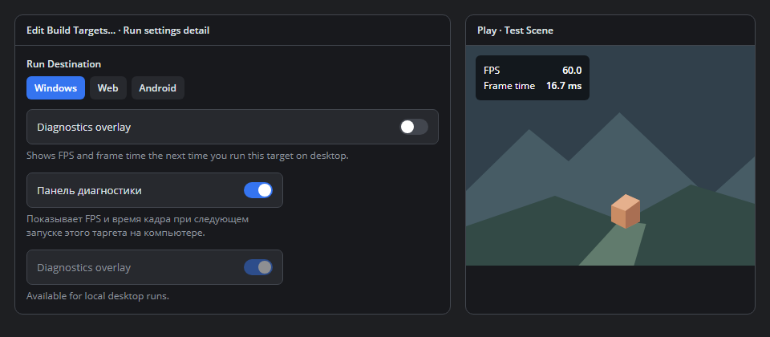

# Game diagnostics overlay

Status: Proposed for approval.

## Purpose

Show how regularly the game is updating while playing it. Bevy's diagnostics
overlay demonstrates the value of keeping frame statistics visible in the game
window. The first AdaEngine version gives developers a small readout enabled per
Studio build target.

## Studio workflow

In the desktop **Edit Build Targets…** dialog, place **Diagnostics overlay**
below **Run Destination** and before executable-specific fields. Use the existing
Studio settings control and explain that the choice takes effect on the next
local desktop Run after saving. Localize the label and help text in English and
Russian. Keep the control usable with keyboard focus, narrow layouts, and
enlarged text. The draft follows the dialog's Save and Cancel behavior.

The flag defaults to off in existing projects and newly created targets.
Duplicating a target copies its value. Switching targets restores the selected
target's value. Persist it as `run.diagnosticsOverlay` using the existing active
target projection and keep it through Project Settings saves.

Support local Windows, macOS, and Linux product Run for AdaScript and for Swift
apps using AdaEngine's standard `DefaultAppWindow` or `WindowGroup` setup. The
flag works with Debug and Release. For other destinations, disable the control
with a short availability hint and retain its saved value. Scene-document Play,
debugger sessions, AdaPlayer, Web, mobile, XR, Movie Maker and export are outside
the first release.

The mockup is a visual proposal. It uses the current Studio settings row,
Open Sans, and the existing dark theme. The game readout is a separate runtime
surface.

## In-game behavior

- Put a compact, high-contrast panel in the top-left safe area of the primary
  game content, above game-authored UI. It must pass input through to the game
  and preserve game layout and focus. Keep its position fixed in this version.
- Display engine update cadence as **FPS** and the mean elapsed time between
  game updates as **Frame time** in milliseconds. The values include pacing and
  stalls between updates. They measure neither GPU execution nor display scanout.
- Use monotonic elapsed time across variable game updates. After approximately
  one second of samples, publish FPS as completed intervals divided by their
  total elapsed time and frame time as the mean of those same intervals. Update
  the text once per sample window. Display dashes while collecting the first
  window and when restarting after an explicit pause. A slow frame during active
  play contributes to the sample. Ignore invalid intervals and reset with the
  game session.
- Keep one overlay per run. Closing the game removes its view and sampler.
  AdaScript hot reload keeps the launch choice and never adds a second overlay.
  With the flag off, allocate no sampler or overlay and install no diagnostics
  update hook.

## Ownership and launch boundaries

The runtime owns the shared sampler and readout. Observe the game's own variable
update path once per tick, outside fixed-step simulation. Give each session its
own sampler so Studio or another game's updates cannot contaminate the metrics.
Use the existing UI compositor and a pass-through top layer to avoid a new camera,
scene entity, renderer timer query, or profiler dependency. Validate ordering
against both game UI and 3D output.

Studio snapshots the active target's setting at launch. For AdaScript, pass it
to the local product Run window explicitly. For Swift, hand it off through the
local child process environment using `ADAENGINE_DIAGNOSTICS_OVERLAY`. Studio
sets it to `1` or `0` according to the saved flag, overriding any inherited value
for that Run. The standard app-window runtime reads that setting on desktop, so
`ADAENGINE_DIAGNOSTICS_OVERLAY=1` also works from a shell with a compatible
engine build. Keep this handoff scoped to the launched process. Exporters,
game source, arguments, and scene data need no generated changes. Swift
executables built against older engines or custom window hosts require a
compatible runtime to use the Studio flag.

Bevy also offers draggable panels, collapsing, configurable rows, and allocator
statistics. A fixed, pass-through readout avoids pointer capture and supplies the
two metrics needed for an initial target setting. More interactive diagnostics
would need their own input and lifetime design.

## Validation and documentation

- Use Swift Testing for sampling with a controlled clock, including constant and
  variable cadence, startup, invalid intervals, pause/resume, and session reset.
- Exercise real temporary projects through decode, save, duplicate, activate,
  and cancel. Verify the enabled target reaches each desktop launch path and
  that default/off, another target, and export paths do not activate the overlay.
- Run both local product paths with UI under the panel. Check visibility and
  absence, UI ordering, clicks through the panel, resize, hot reload, repeated
  Run/Stop, and the English and Russian settings states. Collect rendered
  evidence on Windows, macOS, and Linux with their supported backends. Check
  narrow layouts, text scaling, keyboard focus, and disabled destinations.
- Add `GameDiagnosticsOverlay.md` under the AdaEngine DocC catalog and link it
  from `AdaEngine.md`. Update **Named build targets** in
  `Editor/Documentation/BuildExport.md`, already linked from `Editor/README.md`,
  and regenerate Studio's offline guide snapshot. Explain what the numbers
  measure and which launch paths support the flag.
- Verify the Studio steps with a two-target AdaScript project and the environment
  example with a minimal Swift `DefaultAppWindow` or `WindowGroup` app. Run the
  DocC build, offline-guide check and contribution validation before review.
