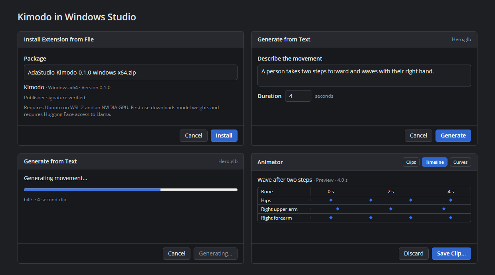

# Kimodo extension for Windows Studio

Status **Accepted**.

## First release

Install a ready-to-run, first-party Kimodo extension on Windows x64 Studio. The
Ada Store card links to a prebuilt ZIP attached to a tagged GitHub Release. In a
compatible Studio release, **File → Install Extension from File…** opens that ZIP.
The user can then generate a skeletal clip from a text description in the Animator
for a supported humanoid GLB. The first release covers one documented rig profile
and the `Kimodo-SOMA-RP-v1.2` model. Video capture and additional rig profiles are
outside this release.

The Studio integration ships in a regular prebuilt Windows release. A user with an
older Studio installation upgrades using the existing installer. Compatible Kimodo
updates install from their own ZIPs. A clean user machine needs neither Swift nor
Visual Studio. The first supported runtime uses Ubuntu on WSL 2 and an NVIDIA
driver with working CUDA access from WSL. NVIDIA documents moving the text encoder
to the CPU to lower VRAM use. Measure this mode on the RTX 4070 before listing
supported hardware on the Store card. The RTX 4070 is visible to CUDA tooling in
WSL on the development machine, and inference there remains to be measured.

## Store and package

- Add a first-party extension listing in `AdaEngine/ada-website` using the Store's
  existing card and detail patterns. Include a short clip, Windows and Studio
  compatibility, WSL and NVIDIA prerequisites, version, and a **Download for
  Windows** action targeting a tested release asset. Use the browser's ordinary
  download flow. The current editor Store router handles project assets on macOS.
- Use a dedicated release workflow for the extension, with independent version
  tags. CI builds and verifies the launch code and any bundled dependencies from
  pinned sources. Publish a prebuilt ZIP, release notes, and license notices. The
  package pins Kimodo, the model revision and the dependency versions it supports.
  Download model weights and any separately hosted prebuilt dependencies into a
  local cache. The official Llama text encoder requires the user's Hugging Face
  authorization. Show that requirement before the first model setup.
- Include a signed manifest in the ZIP with the extension ID, platform, package
  version, minimum Studio version, process protocol version and payload digests.
  Use the Studio release's trusted signing key set to verify the manifest and
  payload before activation. Scope the installer to the first-party Kimodo package
  and a fixed entry point. Reject invalid, incompatible or incomplete archives.
  Stage each version in a per-user directory and switch the active version only
  after verification. Keep the current version usable if an update fails and pin
  an in-flight job to its starting version.

## Animator and execution

Use the existing compact Animator controls, preview viewport, library timeline,
dark theme, and native file picker. **Generate from Text…** opens a form with a
prompt and a duration from 1 to 10 seconds, defaulting to 4. Identify the target
model up front, retain the form after a recoverable failure, and return keyboard
focus to the Animator action on dismissal. During generation, show progress and
offer Cancel. On success, preview the generated motion in the existing viewport.
Use the existing library save flow to name and save it as a new editable clip.
Localize Studio strings in English and Russian.

`AdaEditor` owns package installation, prerequisite checks, background process
lifecycle, progress, errors and preview. Start a known executable with
`wsl.exe --exec` as a normal user. Send the description, duration and job ID as
structured input. The versioned process contract returns status and a bounded
motion result for the same job. Keep a job's result tied to its initial project,
model and rig. A cancelled or stale result leaves the project untouched. Report
missing WSL/CUDA, missing Hugging Face authorization, and incompatible rigs with
specific recovery steps.

`AdaAnimation` owns conversion from SOMA motion to the target rig. Use a
deterministic mapping for the first documented profile and account for the source
and target rest poses, units, axes, bone rotations and root translation. Validate
the resulting tracks and reuse the existing `AnimationLibrary` save and binding
paths. Stored `.animlib` clips play through the existing runtime.

## Acceptance and documentation

- On a clean Windows x64 installation with the stated WSL and GPU prerequisites,
  install the ready-made Studio release. Download the extension using the Store
  card and install it from the ZIP. Run the same setup on an existing installation
  upgraded to the compatible Studio release.
- Generate a wave and two forward steps on the reference humanoid. Confirm the
  intended limbs move, the forward translation survives transfer, the save creates
  editable keys, and the clip reopens and plays after restarting Studio. Record
  cold and warm generation time, peak GPU memory and the initial download size.
- Verify wrong signatures, corrupt downloads, incompatible versions, cancelled or
  failed jobs, an unsupported rig, and a successful package update. Exercise
  keyboard focus, feedback and readability in the rendered Windows editor at
  normal and narrow widths with English and Russian text.
- Add installation, first-run setup, supported rigs, a verified wave example and
  troubleshooting to [`AnimationAuthoring.md`](../../Editor/Documentation/AnimationAuthoring.md).
  Link from the animation section of [`EditorGuide.md`](../../Editor/Documentation/EditorGuide.md).
  Verify navigation and examples in the staged Studio release and include the
  Store card and Windows runtime evidence in independent review.

## References

- [NVIDIA model card](https://huggingface.co/nvidia/Kimodo-SOMA-RP-v1.2)
- [Kimodo setup and hardware guide](https://research.nvidia.com/labs/sil/projects/kimodo/docs/getting_started/quick_start.html)
- [Windows Studio packaging](../Tooling.md)
