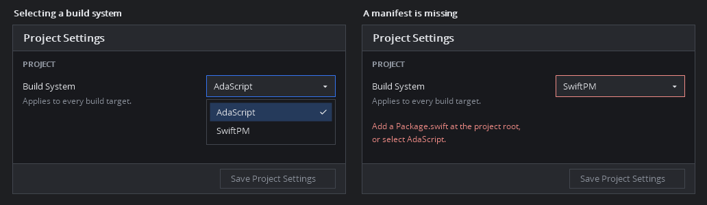

# SwiftPM project settings and target navigation

Status **Proposed for approval**.

## Workflow

MyMinecraft contains a SwiftPM executable whose sources live in `Native/`. Its
Studio metadata selects AdaScript, so Run starts the template scene. On
standalone desktop Studio, add a **Build System** dropdown to **Project
Settings → Project** with **AdaScript** and **SwiftPM**. The existing **Save
Project Settings** action commits the selection. A manifest can coexist with an
AdaScript project. Opening such a project retains its saved build system.

The mockup uses the current Studio settings rows, dark theme, Open Sans and
Material Symbols. Its compact dropdown and inline validation follow the
settings pattern used in IntelliJ IDEA. Use the shared Studio dropdown and
normal focus, hover, pressed, and disabled states. Localize visible text in
English and Russian.

## Build system and Run

- The setting applies to the whole project. On save, update `build.system` and
  every named target's `build.system` together. Keep IDs, the active target,
  and existing target settings, including authored scene references. Existing
  projects keep their saved behavior until a user saves a different value.
- Validate the selected system before saving. SwiftPM requires a readable
  project-local `Package.swift` and a package model with an executable product
  for game Run. Use existing SwiftPM discovery after the user selects SwiftPM.
  Present failures in Project Settings and keep the draft available for
  correction. AdaScript uses existing source and entry validation. Disable
  changes during builds, Run, or debug sessions.
- Changing the build system saves metadata. It does not regenerate the
  manifest, move source files, or apply AdaScript source filters to the SwiftPM
  manifest. Explicit SwiftPM file selection continues to use the existing
  manifest editor. Refresh workspace, tree, and run controls after a successful
  save.
- SwiftPM desktop **Run** starts the selected executable product. Use the
  package's sole executable when it is unambiguous. With several products,
  allow a choice in **Edit Build Targets…** and prompt for one before Run if
  the saved product is missing or invalid. Show **Executable Product** in that
  dialog for SwiftPM. Keep **Startup Scene** in that dialog for AdaScript and
  describe the optional editor scene separately in Project Settings. SwiftPM
  Run works with no scene file or scene reference. AdaScript retains its
  existing scene, root view, and startup-system entry rules.

## Targets navigator

For SwiftPM workspaces, use the existing SwiftPM package model's target names,
paths, and source membership. Include workspace targets with local sources,
including executables, libraries, and tests with custom paths. Assets remain
visible through the existing resource groups. Preserve file selection and
folder expansion across model refreshes. Handle missing or unresolved package
data with a loading or error state and access to **Files**. The AdaScript
navigator continues to use its configured source root. Merely opening a saved
AdaScript workspace does not evaluate its Swift manifest.

The shared desktop settings model owns the draft, project persistence owns the
validated metadata change, and SwiftPM workspace tooling owns package
discovery. Use the existing product Run and scene Play entry points. This
change applies to standalone Windows, macOS, and Linux Studio. Browser, mobile,
and export workflows keep their existing platform support.

## Acceptance and documentation

- Open a real Swift package whose executable target is under `Native/` and
  whose tests have a custom path. Compare the visible target names and files
  with SwiftPM, including exclusions and distinct targets sharing a folder.
- Switch a project with named targets from AdaScript to SwiftPM through
  Project Settings. Reopen it, verify all targets share the chosen system,
  and run a Swift `@main` game without any `.ascn` file. Verify Save and
  Cancel, a missing or invalid manifest, one and several executable products,
  and switching back with the saved AdaScript entry.
- Inspect desktop rendering and keyboard interaction in English and Russian,
  including narrow settings, dropdown states, validation, and save feedback.
  Record a Windows run for the MyMinecraft case and platform evidence for
  macOS and Linux.
- Update `Editor/Documentation/BuildExport.md` with the Project Settings path,
  the Targets behavior and a verified SwiftPM example with a custom source
  root and no startup scene. Keep it discoverable as **Build & Export** in
  the Studio documentation catalog. Regenerate and check the offline snapshot
  with `python Editor/scripts/update-offline-documentation.py --check` after
  running the generator.
