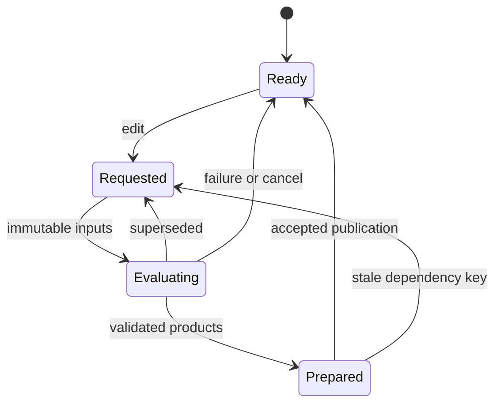
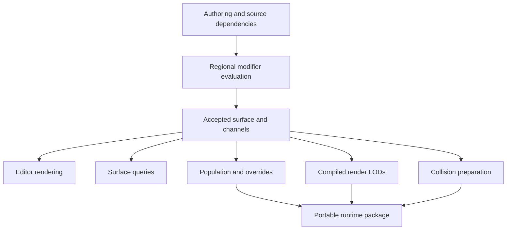

# Terrain Mesh Composition, Surface Materials, and Procedural Population

Status: Approved for implementation; implementation and acceptance pending.
Approval: explicit user approval in this Codex conversation on 2026-11-06.
Date: 2026-11-06. Revision: research-based replacement of the initial short proposal.
Evidence: [Unreal Mesh Terrain research](../Research/2026-11-06-UnrealMeshTerrain.md).
Existing contract: [Terrain Authoring V2](terrain-authoring-v2.md).

## 1. Decision and intended result

Ada Studio should support an editable environment in which a participating tree
root, rock, or other static mesh joins the terrain. Moving the object rebuilds
old and new terrain regions and redistributes generated vegetation and props.
The artist can inspect actual triangles using a portable Wireframe view.

Recommend a shared retained modifier/dependency system with an explicit
**triangle-surface authoring backend for new Mesh Terrain resources**. Keep the
existing heightfield plus local-density backend for compatibility and sampled
solid editing. Both share surface snapshots, material channels, population and
compiled output contracts. They are not silently interchangeable.

This approved design extends Terrain V2 without silently changing its existing
asset contract. It does not claim to clone Unreal internals.
The source research establishes useful behavior and abstractions; the following
contracts and algorithms are Ada choices.

The user explicitly confirmed both ground reconstruction and generated grass/rock
redistribution after moving a participating object. Color blending alone does not
fulfill the requested geometry join. Regeneration must preserve manual intent.

## 2. Goals and scope

| ID | Required outcome |
| --- | --- |
| G1 | Genuine visible-geometry union/stitching with inspectable shared topology |
| G2 | Retained, selectable, movable operands; old locations reconstruct correctly |
| G3 | Consistent geometry, normals, surface channels and material transition |
| G4 | Deterministic generated grass/rocks respond to surfaces and exclusions |
| G5 | Manual placements, paint, exclusions and pinned overrides persist |
| G6 | Bounded local interactive work; no disappearing last-valid surface |
| G7 | Wireframe and Shaded + Wireframe on Windows/WebGPU and macOS/Metal |
| G8 | Save/reopen, relocation, Undo/Redo, Play and export preserve committed results |
| G9 | Independent authoring detail, runtime LOD and attribute density |
| G10 | Compatible existing terrain assets and preserved unrelated editor work |

Use distinct product terms: Combine groups geometry; Stitch joins compatible
boundaries; Union/Subtract resolve participating intersections; Conform deforms
terrain toward an object; Blend controls contact shading; Populate generates
instances. Do not hide these different contracts behind one ambiguous Merge flag.

A full PCG node editor, biological vegetation growth, hydrology, multiplayer
editing, universal non-manifold repair, arbitrary animated operands, lossless
fusion of unrelated shader graphs, gameplay-time execution of the editor graph,
and a Nanite-equivalent renderer are outside the first complete delivery.
Runtime streaming of compiled output is not runtime authoring.

Native desktop authoring is the initial interaction target. Shared runtime data
remains portable to supported engine platforms. Browser-shell and touch authoring
parity require their own interaction proposal and evidence.

## 3. Evidence and verified starting point

Epic's APIs expose a triangle builder, bounded submesh access, interactive sections
and Boolean cut-edge welding. They support the architectural comparison without
establishing exact undocumented algorithms.
[Builder](https://dev.epicgames.com/documentation/unreal-engine/API/Plugins/MeshPartitionEditor/FMeshBuilder),
[interactive section](https://dev.epicgames.com/documentation/unreal-engine/API/Plugins/MeshPartitionEditor/AInteractiveSection),
[Boolean](https://dev.epicgames.com/documentation/unreal-engine/API/Plugins/MeshPartitionEditor/UBooleanModifier?lang=en-US).

| Ada owner | Existing foundation | Missing behavior |
| --- | --- | --- |
| `TerrainManifestAsset`, `Terrain3DSource` | Regions, budgets, streaming, heightfield LOD | Tagged mesh backend and graph document |
| `TerrainVolumeOperation`, `TerrainVolumeField` | Stable ordered sampled union/subtract | Scene binding, general modifiers, triangle operations |
| `TerrainHeightStorage` | Bounded sample edits and persistence | Arbitrary surface sheets and editable topology |
| `TerrainSurfaceQueries` | Committed triangle ray/closest queries | Patch-aware attributes and generalized anchors |
| `TerrainMaterialPalette`, `TerrainMaterialResolver` | Stable IDs, bounded rules, top-four contributions | Semantic channels and durable 3D surface paint |
| `TerrainMaterialTextureArrays` | Shared layer PBR resources | Compiled mesh-surface channel atlas |
| `TerrainInstanceBrushKernel`, `TerrainPlacementAnchor` | Persistent brush records, heightfield reprojection | Actual-surface population and ownership overrides |
| `EditorTerrainResourceWriter` | Saved copied operands | Live bindings and edit/reorder/remove transactions |
| `DebugView3D`, GPU backends | Diagnostic enum; Metal line fill | Working WebGPU edges and editor selection |

The research records the dirty-worktree context. Existing meshlet/LOD resources
can be reused as derived render products; they are not an editable topology kernel
or Nanite. Ongoing terrain-task performance fixes are not assumed finished.

## 4. Artist workflows and observable semantics

### 4.1 Place and join

Place a tree/rock normally, then add Terrain Interaction with a selected target,
operation, participating geometry, optional proxy and contact settings. Preview
bounds, estimated cost and invalid input before mutation. Choose Union for actual
joining or Conform for deformation. Connect existing population rules and inspect
the result in Shaded, Wireframe and Shaded + Wireframe.

For genuine union, selected visible root/trunk geometry participates in generated
output and is removed from its original draw for that accepted revision. Keep
nonparticipating canopy/leaf geometry separately rendered. A proxy which merely
pushes ground is Conform, not a welded visible tree. A proxy supports a genuine
join only through an explicit compatible attachment loop and generated bridge.

### 4.2 Move, delete, cancel

Dragging edits a retained operand rather than applying repeated destructive unions.
Restore the old location by evaluating the base plus remaining operations; update
the new location and affected population. Keep source selection and camera input
usable. One drag is one history transaction; Escape restores source transform,
terrain, overrides and population. Removing/disabling an operand restores its
influence area without deleting the reusable model.

Duplication creates a new modifier identity. Deleting a target produces clear
binding diagnostics and undoable changes, never a dangling live entity pointer.

### 4.3 Inspect a join

Wireframe exposes the actual shared boundary and current triangle density.
Overlay mode shows contact shading against edges. Add local detail where needed;
do not require a global resolution increase. Report internal cracks separately
from intentional exterior boundaries. A skirt cannot stand in for a correct
walkable join or cave boundary.

## 5. Data model and ownership

The following are proposed concepts, not existing callable APIs.

| Record | Required content |
| --- | --- |
| Definition | Stable ID, backend, local frame, channel schema, stage ordering, material palette, section/budget policy, compile profiles |
| Document | Immutable bases, ordered modifiers, population rules, manual overrides, current author revision |
| Base section | Stable ID, geometry reference/hash, transform, boundary/provenance metadata and bounds |
| Modifier | ID, type/algorithm version, order, enablement, target, parameters, dependencies, influence/growth bounds |
| Operand binding | Stable scene entity or standalone source reference, participating submesh selection, relative transform, source fingerprint |
| Surface patch | ID, immutable topology/attributes, BVH, boundary signatures, provenance, channels and memory charge |
| Surface snapshot | Document/geometry/channel revision keys, patch generations, local frame and query capabilities |
| Population rule | ID, weighted prototypes, bounds, seed, density/spacing, filters, exclusions, sampling and ownership policy |
| Placement override | Rule/candidate identity, pin/suppress/transform intent, revision and fallback anchor |
| Compiled section | Product key/profile, render LODs, channels, collision/query products, instance cells and dependencies |

Persistent IDs describe intent. Temporary ECS entities, GPU resources, preview
tiles and triangle indices do not become durable identities. Use project-relative
validated paths and existing immutable-payload/atomic-manifest conventions.

### 5.1 Format compatibility

Introduce a tagged source in a new manifest version: legacy/hybrid or triangle
surface. Continue decoding supported existing manifest and volume documents;
unsupported versions fail without being overwritten. Exact binary/JSON layout
is specified with implementation, including sizes and limits.

An explicit conversion snapshots an evaluated hybrid surface into mesh bases.
It bakes old evaluation rather than recovering nonexistent source UVs or brush
history. Preserve the original resource, support cancellation and make conversion
one Undo action. Do not force arbitrary mesh sections into a one-height-per-X/Z grid.

### 5.2 Revisions and cache keys

Track authoring, geometry, channels, queries, population and compiled products
separately. Material-only changes do not remesh; channel updates invalidate only
declared consumers. Source-content edits invalidate references even if paths stay
the same. Acceptance compares full dependency tuples, not coincident counters.

Use stable content hashes and canonical ordering including algorithm/schema
versions, ordered modifier membership, transforms, source selection and profile
settings. Do not use process-randomized Swift `Hasher` or timestamps as durable
cache identity. Retain old generations while readers/writers need them.

## 6. Geometry representation and feasibility gate

### 6.1 Editable surface

The new backend retains positions, triangle adjacency, corner UV/normal/tangent
attributes, triangle material/provenance IDs, semantic channels and boundary loops.
Editable data is independent from packed render buffers. Sensitive intersection
work uses an appropriate local frame and double precision, with checked conversion
to GPU floats. Welding geometric positions preserves distinct corner attributes
at intentional seams; coincident sheets are not automatically one surface.

| Operation | Contract |
| --- | --- |
| Project/conform | Bounded directional deformation and falloff; no fusion promise |
| Union/subtract | Intersection resolution, classification, internal-face removal, boundary assembly and attribute transfer |
| Stitch | Compatible loop matching, subdivision resolution and explicit ambiguity rejection |
| Local remesh | Constrained split/collapse/flip/relax with provenance/attribute transfer |
| Tessellate | Refine locally with conforming transitions to unchanged neighbors |
| Sculpt | Bounded retained displacement/detail in a defined reference frame |
| Paint | Attribute mutation without incidental geometry changes |

### 6.2 Open terrain versus closed solids

Open surface patches do not satisfy a closed-solid kernel's input assumptions.
Choose and prove oriented open-surface semantics or a temporary local closure
outside the effect bounds. Temporary caps never enter visible/collision/query
output. The strategy must distinguish cave floor, ceiling and intentional opening;
unsupported ambiguous cases fail while retaining valid terrain.

Before production integration, evaluate adversarial fixtures: concave operands,
coplanar/tangent contacts, small features, open patches, reflected/nonuniform
transforms, source attributes, seams, cancellation, worst-case work and native/
WASM delivery. Validate native authoring-kernel packaging separately from compiled
WASM consumption; the editor geometry kernel need not ship inside the player.
Record the selected route in an ADR after evidence.

Manifold is a candidate for closed-solid subproblems, not a proven open-terrain
kernel. CGAL is a candidate/reference for surface processing with package-specific
licensing and packaging constraints. Neither is installed or selected here.
[Manifold](https://github.com/elalish/manifold),
[CGAL package catalogue](https://doc.cgal.org/latest/Manual/packages.html).
A pure Swift route avoids FFI but requires substantial robustness engineering.

The current sampled-density route remains explicit. It is not a silent fallback
for a requested topology/attribute-preserving operation. If the feasibility gate
cannot meet G1 and boundary invariants, return to design rather than relabeling
Conform or voxelization as the missing triangle operation.

### 6.3 Smooth contact and join assets

Separate geometry smoothing radius, maximum permitted deviation, and material
transition width. Use bounded seam relaxation/remesh or an explicit bridge/blend
surface. Preserve sharp features unless rounding is selected. Do not attribute a
smooth-min SDF algorithm to Epic without evidence.

A join asset can identify closed participating visible geometry, protected seams,
optional proxy and attachment boundary. Open leaf cards remain outside solids.
Errors identify the failing selection and a remedy; animated participation uses
an explicitly baked static operand in this version.

## 7. Modifier graph and dependency evaluation

Default stages are Base, Broad Shape, Detail/Composition, Surface Channels and
Population. Store deterministic suborder/ties. Modifiers declare geometry and
channel read/write sets, source dependencies, finite bounds/growth, halos,
precision/error settings and expected topology change. Worker inputs are resolved
immutable values rather than live scene objects.

Procedural geometry generation reads an upstream stage and writes downstream.
Reject dependency cycles with an actionable path rather than iterating until an
unbounded graph happens to settle. Reordering validates prerequisites.

### 7.1 Invalidation and growth

```text
dirty = union(lastAcceptedInfluence, inFlightInfluences, requestedInfluence)
dirty = expand(dirty, geometryHalo + channelHalo + populationHalo)
```

Influence includes smoothing/projection and declared output growth, not only the
model AABB. Propagate expanded output bounds transitively: an operation added on
a newly created ledge must be found even if it lies outside the original base
bounds. Resolve grouping conservatively with finite iterations and a growth budget.

Cache base snapshots, unchanged graph prefixes, operand acceleration and derived
products separately. Account bytes, pin in-flight inputs and evict by bounded LRU
policy. Coalesce changes rather than scanning/rebuilding the world per mouse event.

### 7.2 State and acceptance



Ready's last-valid products survive failures. Obsolete jobs cannot publish.
Cancellation does not delete shared immutable payloads or files still used by
writers. Keep last-accepted, submitted and requested influences distinct.

## 8. Interactive editing and history

Maintain retained authoring input, fast interactive output and compiled products
as related but distinct representations. Reuse unchanged graph prefixes, coalesce
pointer events, bound concurrent jobs and use newest-request-wins per edit.
No full source reload or final collision cooking is required per pointer event.

A reduced-detail or stage-limited preview must be visibly pending. Do not imply
later modifiers already ran. If a provisional object transform precedes its
terrain update, show an explicit ghost/pending presentation. Keep a coherent
accepted surface visible until replacement resources are usable.

Publish seam-connected patches together where independent swaps would crack.
The accepted source transform, source participating-geometry draw mask and fused
patch generation switch atomically. Keep provisional drag ghosts separate from
accepted source draws: moving the canopy/trunk ahead of its fused root would
visibly break the attachment even if patch boundaries were otherwise coherent.
Geometry, queries and channels describe the same accepted surface. Population
visibility swaps use a compatible dependency key, even when prepared separately.
Large updates can group publication by connected region with a declared transition
policy; no unnoticed mixing of incompatible boundary generations is allowed.

One drag captures initial/final graph state and a compatible resource generation.
Undo does not replay nondeterministic input events. Escape restores transforms,
surface, overrides and population. Save atomically publishes a manifest after
payload completion. Do not reload/remesh an entire resource just to create a
history checkpoint; bound retained generations and preserve active readers.

## 9. Boundaries, authoring detail and runtime LOD

Adjacent sections share canonical boundary identity and geometry signatures.
Evaluate topology changes with neighboring context and deterministic ownership.
Both sides agree on geometry/subdivision; intentional shading seams may retain
different corner attributes without opening the surface.

Select crossing triangles even if no vertex is inside the influence box. Test
long triangles, exact boundary/corner contacts and negative coordinates. Distinguish
intentional outer edges from invalid internal cracks. Skirts cannot establish
collision/query continuity at a join.

| Control | Meaning |
| --- | --- |
| Target edge length | Local authoring detail for surface editing/composition |
| Sampled cell size | Precision of the existing density backend |
| Channel sample/texel density | Detail of paint, masks and semantic data |
| Texture scale | Material repetition density |
| Runtime LOD error | Allowed distant visual simplification |
| Population cell size/density | Scheduling and object distribution |

Refine locally with constrained transitions and attribute transfer. Runtime LOD
must preserve shared boundaries or supply validated compatible transitions.
Existing meshlet/LOD data is invalidated with topology and reused where eligible.
Wireframe follows displayed LOD, while gameplay queries/collision use appropriate
independent detail and explicit error limits. Coherent provenance does not require
identical triangle counts.

## 10. Surface channels and durable painting

### 10.1 Semantic schema

Channels have stable ID, name, type/range, default, interpolation, ownership,
runtime-export flag and declared consumers. Examples include soil/rock weights,
moisture, biome, vegetation density, exclusion and contact blend. Reordering or
renaming never reinterprets saved identity. GPU packing remains derived.

Keep semantic channels, layer albedo/normal/ORM/height maps, and optional shading
cache resources distinct. Material layer IDs are categorical; generic masks are
not automatically normalized as if they were a material mixture.

### 10.2 Paint survives topology changes

Do not key paint solely by X/Z or a generated triangle index. Persist ordered
authored strokes/detail against source patch provenance, local anchors, side and
radius, with bounded replay/checkpoints. During remesh retain transfer maps;
continuous attributes interpolate appropriately and categorical data follows
declared selection rules. New cut faces use explicit interior/default rules.

Reprojection is bounded and source/side filtered so floor paint cannot jump to a
ceiling. If correspondence fails, keep intent and expose a recoverable orphan/
reattachment state instead of discarding it. Paint is independent of render LOD
and atlas packing. Erase removes the selected manual override, revealing rules;
it does not erase unrelated material or population data.

Paint attachment has an explicit intent frame: base-ground paint remains terrain-
local; source-owned bark/root paint follows the operand-local frame; procedural
contact weights regenerate. Paint on generated bridges/cut faces uses a declared
source or terrain owner and becomes recoverably orphaned if its surface disappears.
Do not drag soil paint with a tree or leave source-owned paint behind through an
unfiltered nearest-surface projection. These ownership rules apply to persisted
stroke coordinates independently of texture projection settings.

### 10.3 Compiled channel atlas

Bake accepted channels into section charts with independent coverage for stacked
sheets, gutters, mip policy, distortion/byte limits and retained provenance.
Channel lookup UVs differ from source-material UVs. Categorical IDs use discrete
fetch; interpolate weights rather than averaging IDs. Shared borders/mips must
agree. Repacking cannot move authoritative paint or placement identity.

Reuse existing texture-array support where suitable. Exact formats, chart
generation and budgets are feasibility outputs, not claimed copies of Epic's
undocumented packing. Separate authoring channel resolution from compiled texels.

## 11. Material composition

### 11.1 Bounded layer evaluation

Extend stable palette IDs, existing top-four contributions, deterministic pruning
and fallback/interior layers. The default order is automatic rules, then procedural
contact contribution, then authored manual override, then deterministic top-four
pruning and normalization. Contact regeneration never overwrites authored paint;
erasing the manual override reveals the current contact/rule result. Painting
another semantic channel does not implicitly alter this material precedence.
Height/slope/noise use the chosen local frame and actual surface
position/normal, including walls and ceilings.

Mix base color in linear space, normals in a common frame followed by normalization,
and scalar PBR values using documented representation-aware interpolation. Preserve
engine lighting/shadow conventions. Do not promise physically exact mixing of
arbitrary shader graphs. Height-biased texture weights change shading, not geometry;
displacement requires a separate geometry/query/collision contract.

For automatic weight vector `a`, normalized contact contributions `c`, contact
strength `t`, authored normalized paint `p` and override strength `m`, use:

```text
b = (1 - t) * normalizeOrFallback(a) + t * normalizeOrFallback(c)
w = (1 - m) * b + m * p
result = normalizeOrFallback(stableTopFour(w))
```

This equation is an Ada layer policy, not a description of Epic's shader.
Multiple contact writers compose in retained modifier order. Preserve intermediate
full-palette weights until final bounded selection where feasible. IDs are sorted
for ties; zero total weight uses the fallback. Height-biased blends operate on
shading weights with a documented width and do not change geometry. Test zero
weights, ties, complete/partial overrides and erase after operand movement.

### 11.2 Contact appearance and source materials

A join writes provenance and optional contact weights in a finite band. Assign
supported transition layers with independent geometry/shading widths. Unchanged
bark may retain source UVs; generated bridge/cut faces use explicit local projection
and contact/interior materials. Canopy and nonparticipating surfaces retain their
own materials. Hide original participating draws only when the replacement is ready.

Unsupported transparency, wind and custom graph semantics remain separate or require
explicit conversion. Do not silently flatten them into terrain. Material transitions
must include roughness/normal behavior, not just a color fade.

### 11.3 Projection and repetition

Retain planar mapping for ground and triplanar options for generated cliffs/roots/
ceilings. Handle normal axis/sign changes and reflection handedness. Choose source-
local bark versus terrain-local soil coordinates intentionally and describe whether
patterns move with an object. Reuse seeded flips, rotations, offsets and macro
variation consistently across each layer's associated maps. Camera/chunk identity
must not randomize texture patterns.

### 11.4 Optional shading cache

An RVT-like view-independent cache is a later measured optimization, not a required
correctness mechanism. Eviction cannot lose paint or change collisions. A top-down
capture cannot uniquely address all cave sheets; use charts or explicit multi-
surface addressing. Start with the direct channel route and profile it before
adding a new virtual-texture subsystem. Writers/readers declare dependencies and
invalidate old/new stamp regions. This cache cannot substitute for a genuine join.

## 12. Procedural population and manual intent

### 12.1 Inputs and actual-surface sampling

Rules define weighted prototypes, finite bounds, stable seed, density in stated
units, spacing, scale/yaw, normal alignment, offsets, channel/height/slope filters,
allowed side, exclusion distances and cell scale. Consume a named accepted
upstream surface/channel stage.

Sample actual patches/triangles and density per surface area where appropriate.
A downward heightfield ray cannot cover walls, ceilings and stacked ledges.
Simplified physics geometry is not the authority for visual placement.

### 12.2 Determinism and boundaries

Candidate keys derive from rule, canonical terrain-local cell, candidate lattice
and stable surface/provenance choice, not triangle enumeration or job order.
Use bounded multi-hit/patch selection for multiple sheets. A seed by itself does
not preserve IDs through arbitrary topology changes; define controlled reattachment.

Resolve spacing across cell edges with sufficient neighbor halos and deterministic
priority. A finite-radius local priority exclusion rule is acceptable initially
even if less dense than globally maximal Poisson sampling. Density is a target
under constraints, not an exact count. Streaming or reversed job order cannot
reshuffle unchanged output. Include maximum spacing/exclusion/prototype extent in halos.

Default spacing uses Euclidean distance in terrain-local length units within the
same attachment sheet/provenance group. Separate floor/ceiling sheets do not
compete merely because they share X/Z. Cross-sheet overlap is an explicit optional
clearance test using prototype bounds. Exclusions use 3D object-space shapes
transformed to terrain space, expanded by their selected distance, not an implicit
2D footprint or geodesic measure. Nonuniform terrain transforms require documented
unit conversion for world-space clearance; spacing retains the declared local metric.

### 12.3 Ownership

| Kind | Persistent authoring data | Regeneration |
| --- | --- | --- |
| Manual | Explicit placement and anchoring policy | Preserve intent; only reattach under selected policy |
| Generated | Rule and stable candidate identity; optional derived cache | Recompute affected cells deterministically |
| Pinned/edited generated | Override plus fallback anchor | Preserve; report unsupported attachment as an orphan |
| Suppressed generated | Tombstone or exclusion | Do not respawn on regeneration |

Use versioned rows/sidecars for ownership; never infer it from transient entities
or an ID bit pattern. Unpin/restore are explicit. Seed changes affect generated
records while retaining manual intent. Rule deletion previews override consequences.

### 12.4 Movement and anchors

Rebuild geometry, derive changed channels, then regenerate affected cells with
spacing/exclusion halos. The old footprint becomes eligible again. Unchanged
cells retain hashes, IDs and GPU resources. Multiple rules may exclude grass
close to roots while introducing litter/small rocks in a wider band.

General anchors retain position, normal/side, provenance, search radius and last
generation. Reattach by provenance, then bounded compatible closest-surface query;
never snap through a thin wall. Disappeared surfaces remove unmodified derived
candidates but expose recoverable states for pinned/manual intent.

Reuse shared prototypes, instance buffers and batching/culling. Avoid one authored
or full runtime ECS entity per blade. Decorative collision defaults off; opt-in
nearby props have independent budgets. Persisted CPU-owned rules/intent are the
initial route; GPU-only ephemeral scatter needs separate save/debug/physics semantics.

## 13. Preview, query, collision and compiled products



Compile profiles select visual error/LOD, channels, collision error and population
products. Persist product dependencies and algorithm versions. Preview actors are
not durable attachment identities.

Editing may postpone collision cooking. Play waits for compatible committed
products or reports pending work. It cannot pair a new cave opening with an old
closed collider. Simplification preserves clearance and protected seams within
declared tolerance. Test actual traversal and standing on joined ledges.

Queries follow the accepted intended surface even when the render LOD is coarser.
Provide diagnostics for differences. Navigation, if connected, needs its own
acceptance; collision does not prove navmesh correctness. Do not introduce a new
navigation subsystem as a hidden prerequisite.

Export consumes compiled output without the editor evaluator by default. Stale
or missing products trigger a rebuild through the existing workflow or an
actionable failure, never silent export of obsolete terrain.

## 14. Portable Wireframe inspection

### 14.1 Native editor control

Use the previous proposal's compact shared dropdown direction: Shaded, Wireframe,
Shaded + Wireframe. Ship English/Russian labels, tooltips, visible selection/focus,
keyboard navigation, Escape/outside dismissal and focus return. The selection is
editor-local, survives navigation/publication and does not change authored cameras,
materials or Play. Omit it in 2D; keep 3D model-preview diagnostics consistent.

The prior schematic is a proposal, not native rendered evidence. Verify it against
the current toolbar before UI edits. Use Studio theme/fonts and test narrow layouts,
long labels and persistent selection after hover exit. Touch parity is separate.

### 14.2 Rendering contract

Draw actual displayed triangle edges, not a grid, box, meshlet border or different
LOD. Cover static, instanced, skinned/morphed and generated terrain paths supported
by the viewport. Report unsupported paths before claiming viewport-wide completion.

Recommend cached edge-index geometry and a portable line pass. Standard WebGPU
exposes line topology rather than polygon line-fill state.
[WebGPU primitive state](https://www.w3.org/TR/webgpu/#primitive-state).
Reuse source deformation/transforms; generate canonical triangle edges once per
geometry revision/LOD. Normalize nonindexed geometry during preparation if needed.

Use compatible depth so hidden edges are occluded. Pure Wireframe uses neutral
surfaces/background and edges; overlay retains authored shading. Line topology has
different culling/bias constraints, so define shader/depth/silhouette handling;
do not copy unsupported polygon depth-bias settings. A barycentric triangle route
is an alternative if quality/performance justifies attribute and memory cost.

Reuse actual per-view visibility and selected meshlet hierarchy branches, including
mixed-detail clusters within one part, rather than only the asset-level LOD number.
Edge ranges correspond to submitted triangle ranges. If diagnostics cannot reuse
that selection, explicitly choose a compatible geometry route for both surface
and edges, label that choice, and do not overlay different-LOD edges while calling
them current displayed topology.

Cache by resource lifetime with explicit byte charges. Disabled mode performs no
edge preparation/drawing. Animated geometry reuses deformation without per-frame
CPU topology extraction. Diagnose path tracing/upscaling through an explicit
compatible raster route and restore authored settings on return to Shaded.

## 15. Modules and Swift isolation

| Owner | Responsibility |
| --- | --- |
| `Math` or reviewed low-level geometry target | Renderer-independent topology kernels and validation |
| `AdaAssets` | Versioned documents/products, validated references, atomic persistence |
| `AdaScene` | Evaluation, patches, streaming, queries, population and committed revisions |
| `AdaRender` | Render/edge resource representation and backend support |
| `AdaCorePipelines` | Material/diagnostic passes, visibility and LOD integration |
| `AdaPhysics` | Collider preparation and supported simplified products |
| `Editor/AdaEditor` | Scene bindings, transactions, UI/status and localization |

Do not force a dependency-heavy topology library into lightweight `Math`; evaluate
a narrow target in the kernel ADR. Keep the `AdaEngine` facade thin.

Use value types and immutable `Sendable` snapshots for workers, `@MainActor` for
editor interaction, existing world isolation for publication and structured
cancellable tasks. Caches have explicit synchronization/lifetime. Avoid detached
tasks, unsafe isolation and blocking IO in pointer callbacks. Prepare GPU resources
through their owning API and budget work before world publication.

## 16. Budgets and measured responsiveness

Charge source decode, editable topology/attributes, BVHs, operation scratch,
prefix caches, channel atlases/mips, CPU/GPU instances, edge buffers and collision.
Account for simultaneously live old/new generations. Existing mesh budget values
do not cover arbitrarily many new uncharged products.

For planning only, 100,000 triangles require at most 600,000 directed endpoint
indices before deduplication: about 2.29 MiB at 32 bits each. A mostly closed
manifold often approaches 300,000 endpoint indices after shared-edge deduplication,
but this is an estimate, not an allocation guarantee. A 1024-square RGBA8 ID map
plus RGBA8 weight map costs 8 MiB before mips/gutters, about 10.67 MiB with a full
mip chain. Arbitrary extra channels, CPU copies and live generations add cost.

Likewise, a direct four-layer, three-axis triplanar path reading base color,
normal and ORM can require 36 texture samples before blend-height, variation or
additional lighting. These arithmetic estimates motivate separate geometry/channel/
shader budgets; they are not measured costs of the current renderer or UE.

Bound touched triangles, candidate visits, source validation, remesh iterations,
charts, decoded images, queued jobs and growth. Expensive loops support cancellation.
Failure retains valid output and names the limiting setting with a useful remedy.

### Proposed targets, not measured results

On a recorded reference desktop fixture, target pointer/navigation CPU p95 no more
than 16.7 ms, first meaningful local preview p95 no more than 100 ms, and local
release-to-accepted-preview p95 no more than 500 ms. These apply to a declared
bounded edit, not all terrain sizes/hardware.

The reference edit has a 16-unit influence, at most 100,000 touched triangles,
32 active geometry modifiers and 100,000 decorative instances across the terrain.
Record affected cells/candidates and hardware. Establish feasibility before
promising these targets. Large intentional builds may remain pending/cancellable
while navigation continues; missing measurements cannot be labeled real time.

Measure warm/cold p50/p95, worker/publication stages, longest main-thread stall,
changed patches/cells, cache hits, peak live bytes, uploads, draw counts and GPU
time. Use the repository harness on quiet hardware and include a mounted native
interaction; a helper benchmark alone does not establish editor responsiveness.

Expose modifier timing, pending/accepted/error state, bounds, triangle counts,
edge length, channel views, population ownership and generation. Keep ordinary
artist flows free of unnecessary rendering implementation jargon.

## 17. Failure and compatibility behavior

| Case | Required behavior |
| --- | --- |
| Missing/changed source | Useful diagnostic; no silently accepted stale dependency |
| Open/invalid solid | Reject Union; offer explicit Conform or repair guidance |
| Non-finite/singular transform | Reject before mutation |
| Reflection/nonuniform scale | Correct normals/winding/collision or explicit unsupported error |
| Degenerate/coplanar/tangent contact | Tested valid output or preserved prior generation |
| Superseded/canceled worker | No late publication or deletion of shared active payloads |
| Budget exhaustion | No partial replacement or loss of authored channels/placements |
| Lost correspondence | Retained intent with recoverable reattachment state |
| Relocation | Portable relative references; outside-root/traversal rejected |
| Unsupported compile profile | Explicit failure or declared compatible fallback |
| Stale runtime products | Rebuild or actionable failure before export/Play |

A conventional LOD fallback can replace optional meshlet rendering while preserving
the surface. A fallback cannot silently remove caves or required channels to fit
a budget. Readers never rewrite unknown formats as a truncated supported subset.

## 18. Acceptance fixtures and platform evidence

Use Swift Testing and production storage/geometry/render/event paths. The current
research task does not report these future checks as passed.

| Fixture | Evidence required |
| --- | --- |
| Root union on uneven ground | Shared visible boundary, material/normal continuity, preserved canopy |
| Drag across a four-section corner | Old region restored, new join correct, one Undo/Redo and full Escape rollback |
| Slow drag build with accepted tree draw | Source transform/draw mask and fused patch switch together; provisional ghost never detaches accepted canopy |
| Overlapping operands, one removed | Remaining order and authored edits retained |
| Floor/bridge/ceiling at same X/Z | Independent paint, population and anchors |
| Paint ground and roots, then move operand | Ground paint stays terrain-local, source paint follows source, contact regenerates and lost bridge paint remains recoverable |
| Paint over contact, move operand, erase and Undo | Manual override wins; erase reveals current contact/rules; Undo restores intent and compatible generations |
| Cave mouth, long crossing triangles | Correct regional inclusion, seams, picking and clearance |
| Modifier on a newly added ledge | Transitive output-growth dependency included |
| Local remesh/density transition | No T-junctions; transferred attributes; unaffected section hashes retained |
| Mirrored/nonuniform operand | Correct winding, materials, normals and collision |
| Invalid card/open operand | Actionable rejection without history/resource mutation |
| Manual/pinned/suppressed instances | Survive regeneration, seed updates, streaming and save/reopen |
| Reversed/concurrent population jobs | Identical IDs, boundary spacing and ownership |
| Offset simplified collision | Placements follow accepted intended surface |
| Rapid edits and slow worker | Stale geometry/population never publishes |
| Cache eviction/cold reopen | Same result under bounded memory |
| Wireframe for all supported mesh paths | Correct current LOD/deformation, occlusion and Shaded restoration |
| Mixed meshlet hierarchy cut within one part | Edge ranges match actually displayed selected branches, not source or asset-level LOD alone |
| Packaged example, Play and export | Valid dependencies; actual traversal/standing on modified terrain |

Render real GPU pixels on Windows/WebGPU and macOS/Metal for joins, normals,
ceilings, material/channel boundaries and edge modes. Run applicable WebGPU/Tint
checks for shader/backend changes. Exercise dropdown default, hover, pressed,
focused, selected, open and disabled/error states where applicable in English/
Russian and narrow/normal layouts.

Validate supported Linux/mobile/WASM runtime/build paths affected by shared changes.
Unavailable hardware/toolchains remain blocked/unverified, not passed. Record
commands, fixtures, screenshots, failure diffs and latency/resource traces. Native
desktop authoring scope does not waive existing runtime platform compatibility.

## 19. User documentation and examples

Update `Editor/Documentation/Terrain.md` with place/join/move/populate/inspect,
join-asset preparation, manual overrides, precision/performance settings, migration
and failure recovery. Link relevant sections from `Editor/Documentation/EditorGuide.md`
and `Editor/README.md`.

Extend `Sources/AdaEngine/AdaEngine.docc/Articles/3D/Terrain.md` for backends,
surface queries, compiled products and runtime limits; maintain Topics navigation
in `AdaEngine.md`. API comments complement, not replace, the user article.

Ship a reproducible prepared-root/rock fixture with a true union, conform-only
prop, painted floor/ceiling, automatic population and manual overrides. Build the
actual example and exported result. Regenerate offline documentation with the
maintained generator and run its `--check`; do not hand-edit generated catalogs.
Research/design prose does not count as this shipped guide.

## 20. Subsequent delivery boundaries

These are design acceptance boundaries, not an approved implementation schedule.

| Boundary | Reviewable result | Condition |
| --- | --- | --- |
| Geometry feasibility | Adversarial fixtures and kernel comparison | G1/boundaries/attributes and packaging proven; ADR selects route |
| Portable inspection | Native selector and real GPU edges | G7 with LOD/deformation/occlusion evidence |
| Retained authoring | Versioned backend, graph, live bindings and interaction | G1/G2/G6/G8/G10 across save/Undo/Play |
| Surface shading | Durable channels/contact material/remesh transfer | G3/G5/G9 on walls/ceilings and both backends |
| Population | Surface rules, ownership, overrides and local updates | G4/G5 with deterministic movement/boundary fixtures |
| Integrated delivery | Packaged example, docs, export and profiling | All goals and applicable checks covered |

No slice closes the overall feature while another required result is missing.
After human approval, record exact owned files and commands in the implementation
plan. Coordinate overlapping changes with the active terrain task. Do not weaken
contribution rules or suppress checks to report an unfinished feature complete.

## 21. Remaining decisions and approval boundary

Recommend mesh-native authoring, direct channels/materials, persistent CPU-owned
population and a portable edge pass. The remaining choices require evidence:

1. Select the geometry kernel and open-surface strategy using the feasibility gate.
2. Select channel formats/charts/gutters and budgets using GPU-limit/quality tests.
3. Validate interaction targets on declared hardware; tune section sizing and
   scheduling before making real-time claims.
4. Add an RVT-like cache only if profiling shows a benefit over the direct route.

Public Unreal sources do not settle these Ada-specific choices. Human review
approves behavior and boundaries; feasibility determines implementation. This
document is approved for implementation; completion requires all stated behavior
and acceptance evidence. Independent review follows implementation of the entire
agreed functionality, as explicitly requested by the contributor.
