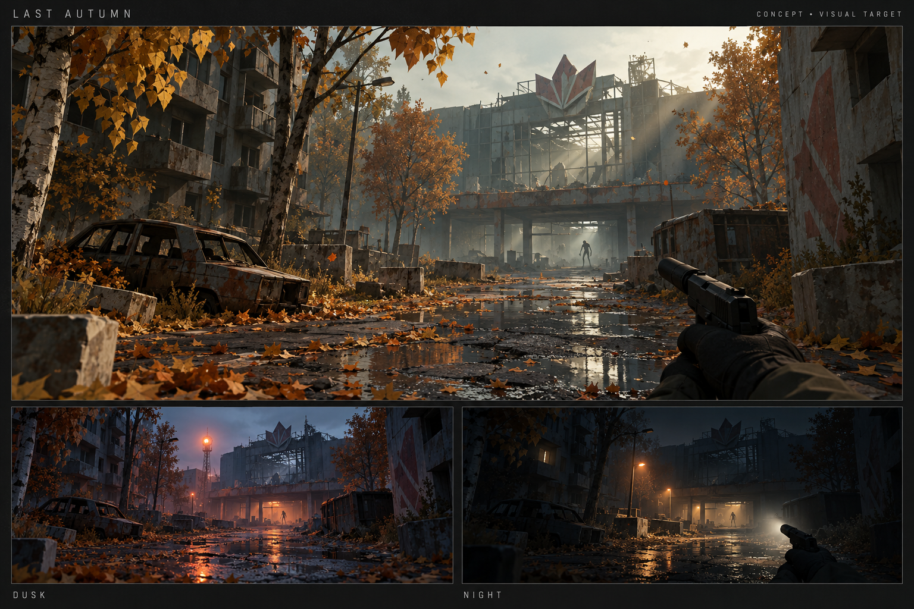

# Last Autumn — визуальное задание

Визуальная цель: качественная 3D low-poly сцена, где ручные формы и материалы
освещены правдоподобно. Концепт — ориентир постановки, не кадр из AdaEngine и
не свидетельство работающей игры.

`Concept.png` создан встроенным `imagegen` 24 октября 2026 по этому заданию.
Это оригинальный визуальный ориентир без внешних референс-изображений,
не Blender-ассет, не GLB и не фактический рендер игры. Исходный результат
сохранён без редактирования. Детализацию настоящих low-poly моделей держать
в рамках бюджета; насыщенность текстур концепта не копировать автоматически.

## Контрольный кадр

Камера на уровне груди, на переднем плане руки и компактный пистолет с
глушителем. Узкая улица открывается в широкий двор; мокрый асфальт ведёт взгляд
к разрушенному торговому центру. Справа светлые стволы и золотые кроны,
слева потемневший бетон жилого дома с проломом. Низкое солнце сквозь кроны
рисует длинные тени и несколько выраженных лучей в холодном тумане.

На земле оранжевая листва и небольшие лужи. В глубине под козырьком — один
едва читаемый неправильный человеческий силуэт. Нет толп и сплошного свечения.
Архитектура угловатая, масштабы человеческие; микродеталь текстур не забивает
плоскости. Зелень заражения приглушена и заметна только вблизи.

Три версии одной постановки: золотой поздний день, синевато-серые сумерки,
ночь с ограниченным фонарём и тёплым светом выхода. Геометрия и камера общие:
так можно сравнить свет и не спутать смену настроения с новой композицией.

## Первый набор Blender-ассетов

- Жилой фасад: целая секция, разбитая секция, угловой модуль, лестница, кровля.
- Торговый центр: витрина, козырёк, входная группа, вывеска, обломки перекрытия.
- Три дерева, два куста, шесть групп опавших листьев, листовые карточки.
- Машина, фонарь, скамья, ограждение, контейнер, кабели, терминал и люк.
- Руки/оружие и один оригинальный заражённый с базовыми клипами.

Каждый ассет получает `.blend`, scale/pivot contract, GLB, LOD при необходимости,
collision proxy, перечень материалов и происхождение. Риги и клипы проверяются
в AdaEngine после Blender, включая движущуюся тень.

## Кадры для приёмки

1. Контровой свет в дворе: видны тени/лучи от веток, без чрезмерного bloom.
2. Интерьер: свет через разбитое окно, тёмные углы остаются читаемыми.
3. Ночь: дальний ориентир и фонарь, автоматическая экспозиция не обеляет кадр.
4. Монстр: ясный силуэт, корректная анимация/тень, без ошибок позы и масштаба.
5. Движение: короткий проход с поворотом, спринтом, прыжком и настройкой тряски.

Предпросмотр рендера Blender и AI-концепт должны подписываться отдельно от
кадров Play. Их нельзя выдавать за достигнутую графику AdaEngine.
