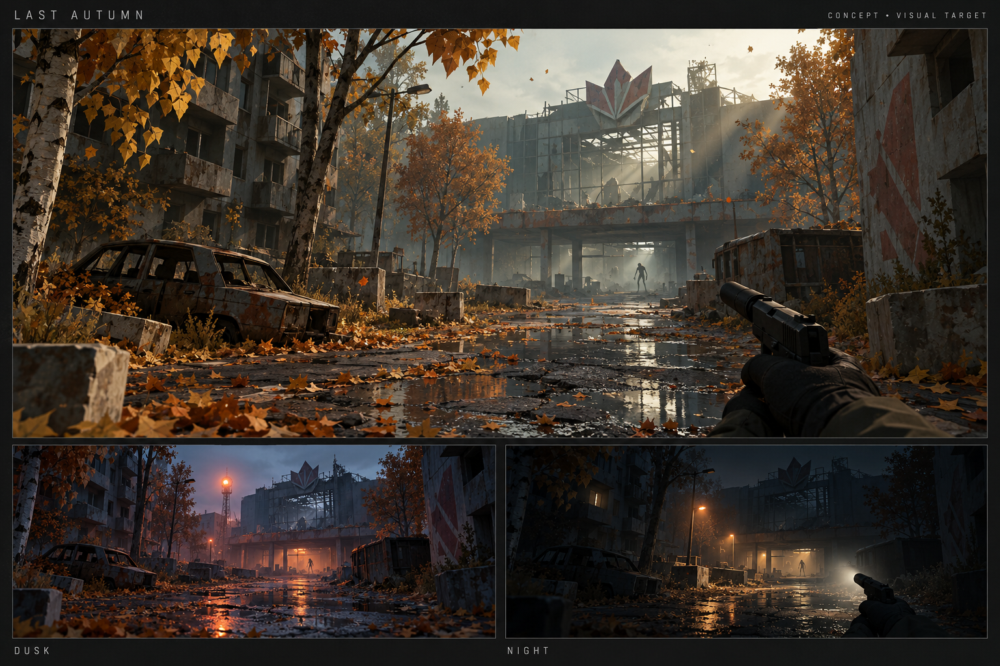

# Последняя осень — игровой и визуальный бриф

Дата: 24 октября 2026. Рабочее название: **Last Autumn / Последняя осень**.
Состояние: карта утверждена пользователем; этап 01 локально реализован и проверен.
Подробности и текущие ограничения — в [фактическом отчёте](Progress.md).



AI-концепт показывает предлагаемую постановку дня, сумерек и ночи. Геометрия,
свет и материалы настоящей игры будут отдельно проверяться в Studio Play.

## Игра

Кооперативный extraction horror от первого лица в осеннем городе, который
пришельцы превращают в живой организм. Красивый, тихий город и редкие страшные
силуэты работают сильнее непрерывных волн врагов. За 30 минут нужно выполнить
контракт, найти полезные вещи и добраться до ещё открытой эвакуации.

Ключевые опоры:

- Тактильное движение и инерция камеры/оружия с ощущением нательной камеры.
- Ясная угловатая low-poly геометрия, убедительные материалы и свет.
- Шум меняет маршрут и риск: выстрел решает локальную проблему и создаёт новую.
- Добыча ценна только после эвакуации; смерть уничтожает принесённую экипировку.
- Напарник помогает выжить, но его заражённое тело может вернуться против игрока.

## Предлагаемые стартовые решения

| Решение | Предложение |
|---|---|
| Первая платформа | macOS, клавиатура/мышь, Metal |
| Авторинг | Ada Studio, сохранённые `.ascn`, импортируемые `.glb`, интерфейсы `.ui` |
| Игровые правила | AdaScript: компоненты, системы, контракты, AI, инвентарь, рейд |
| Swift | Переиспользуемые возможности движка, физики, рендера, ввода и сетевого моста |
| Место проекта | `Demos/LastAutumn/` в AdaEngine; игровую логику не помещать в `Sources/` или `Editor/Sources/` |
| Первая проверяемая версия | Одиночная; кооператив на двух игроков после работоспособного рейда |
| Карта полной версии | 1024 × 1024 м, 16 × 16 секторов по 64 м; размеры — исходная цель для профилирования |
| Первый визуальный участок | Авторский двор и часть улицы примерно 160 × 160 м |
| Художественный приоритет | Качество первого участка и читаемость маршрута перед размножением кварталов |
| Модели/анимация | Собственные Blender `.blend` и воспроизводимые рецепты экспорта; внешние клипы только с сохранённой лицензией |

Это исходные решения, а не дополнительные ограничения пользователя. Консоли,
мобильные платформы, публичный матчмейкинг и сервис аккаунтов требуют отдельного
решения; браузер не является критерием первой версии.

## Визуальное направление

**Светлая меланхолия днём, опасная пустота ночью.** Охристые берёзы и клёны,
холодный бетон, мокрый асфальт, редкие тёплые окна, разбитые витрины. Вдали
силуэт торгового центра и водонапорной башни помогают ориентироваться.

| Роль | Палитра | Применение |
|---|---|---|
| Листва | `#D6A13D`, `#B87532` | Золотые кроны, опавшие листья, низкое солнце |
| Архитектура | `#7A796C`, `#494E4A` | Бетон, камень, оцинкованный металл |
| Холодная среда | `#536769`, `#9AADA4` | Тени, низкий туман, пасмурное небо |
| Безопасность | `#E5C78B` | Лампы базы и точек эвакуации |
| Заражение | `#A8B49A`, `#704F48` | Бледная ткань, кость, редкие внутренние огни |

Low-poly означает осмысленные силуэты и плоскости, а не одинаковые кубы вместо
домов. Материалы разделяют сухой и мокрый бетон, ткань, кость, стекло и металл.
Разрушения композиционные: провал крыши, пустая квартира, перекошенная галерея,
оборванная лестница. Динамическое разрушение зданий не требуется для этой игры.

Световая постановка: низкое солнце, тени от веток и оконных рам, видимые в тумане
лучи, ограниченный bloom на ярких бликах, спокойная цветокоррекция. Отдельный
солнечный lens flare не заменять общей засветкой bloom. Предусмотреть его
окклюзию зданиями. Вода/лужи должны сохранять правдоподобный вид при потере SSR
за границей экрана; SSR не считать полноценным отражением всего мира.

Падающие листья движутся отдельными локальными облаками вокруг игрока. На земле
лежат дешёвые группы геометрии. Ветер объединяет покачивание крон, движение
листвы и звук; дальняя растительность не симулируется по листу.

Ночью читаются силуэты, фонарь и ориентиры. Экспозиция ограничена: автоматическая
адаптация не должна превращать ночь в день. Сильное размытие и тряска отключаемы.

## Камера и движение

- Капсула персонажа, устойчивые контакты со ступенями/склонами, прыжок и падение.
- Движение корпуса отделено от поворота взгляда: небольшое запаздывание оружия,
  пружинная отдача, наклон при смене направления, дыхание и шаги.
- Стартовая обычная скорость 3.5 м/с, бег 5.8 м/с, тихое движение 1.4 м/с;
  значения подлежат настройке на игровом участке.
- Бег, прыжок, перекат и карабканье тратят выносливость и создают разные звуки.
- Карабканье проверяет край, место для капсулы наверху и препятствия по пути.
  Перекат сохраняет столкновения; не даёт автоматической неуязвимости.
- Приседание меняет коллизию; вставать под низким потолком нельзя.
- Настройки FOV, чувствительности, инверсии, тряски, виньетки и эффекта линзы.
  Стартовый FOV около 90°; точную ось FOV согласовать с API камеры при реализации.
- Курсор захватывается только при активной игре; Escape открывает меню.

Визуальное ощущение Bodycam переносится через массу, экспозицию, перспективу и
движение, с оригинальными ассетами и собственной постановкой.

## Рейд и добыча

Петля: **база → выбор снаряжения/контракта → случайный безопасный вход → поиск,
бой или обход → эвакуация → склад и следующая вылазка**.

Таймер рейда — 1800 секунд. Авторитетное время симуляции не зависит от FPS и
изменения системных часов. В одиночной игре пауза приостанавливает симуляцию;
в кооперативе меню её не останавливает. В 30:00 неэвакуированные участники
считаются потерянными. Начатая, но не законченная эвакуация не спасает игрока.

Три исходные точки эвакуации:

| Точка | Закрытие | Цена выхода |
|---|---|---|
| Крыша торгового центра | 18:00 | Вызов и ожидание вертолёта создают громкий шум |
| Северный технический люк | 25:00 | Нужны питание и открытая заслонка |
| Южный водоотвод | 29:30 | Тесный подход, ограниченная видимость |

В первой версии работают две точки на малом участке; третья появляется вместе
с полной картой. Карта/радио заранее показывает закрытие. При генерации входа
проверяется доступный пеший маршрут хотя бы к одной точке. Входы не размещаются
в коллайдере, на недоступной крыше или в непосредственном бою.

Предлагаемый рюкзак — сетка 6 × 4 плюс слоты оружия и экипировки. Размеры
предметов и масса ограничивают добычу. Нельзя подобрать предмет, если он не
помещается; подтверждённый перенос атомарен. Предмет имеет уникальный ID,
а повторный сетевой запрос не создаёт копию.

Исходная добыча: патроны, аптечка, батарея, электроника, фильтр, детали оружия,
образцы заражения и ценные вещи. Контракты: снять данные с терминала, собрать
два образца, восстановить питание выхода. В рейде выбираются 1–2 контракта.

Склад на базе сохраняется между запусками. Экипировка резервируется при старте
рейда и не дублируется на складе. Выживший переносит с собой эвакуированный
инвентарь; погибший теряет всё, что унёс на карту, и всё, что там собрал.
Предметы, оставленные на базе, сохраняются. Тело доступно для обыска товарищу
до конца рейда. Сохранение результата имеет уникальный ID рейда и переживает
повторную доставку события/перезапуск. Принудительное закрытие активного
рейда не возвращает зарезервированное снаряжение.

## Бой, слух и заражённые

Первое вооружение: нож, пистолет с устанавливаемым глушителем, карабин.
Прицеливание, магазин/патронник, перезарядка, отдача, проба попадания по миру,
кровь/пыль и звук поверхности важнее большого каталога оружия.
Глушитель сокращает распространение звука, но не делает оружие бесшумным.

Шум имеет позицию, громкость, тип и срок жизни. Шаги зависят от поверхности и
скорости. Выстрел, сигнализация и эвакуация слышны дальше. Препятствия ослабляют
звук; видимость и слух проверяются раздельно. Монстр идёт к последнему
услышанному месту, ищет и возвращается к патрулю, если не нашёл цель.
Рост локального шума увеличивает приток существ с ограничением плотности,
без появления на глазах или прямо за спиной. Проверка: тихий и громкий проход
одного маршрута с одинаковым seed дают измеримо разный уровень угрозы.

| Существо | Поведение | Силуэт |
|---|---|---|
| Согнутый | Человек ближнего боя; ищет источник звука и рывком сближается | Асимметричная спина, длинные руки, запоздалые движения головы |
| Звонарь | Дальняя атака биологическим снарядом с читаемым замахом | Раскрытая грудная полость, высокий ломаный силуэт |
| Гончая | Изменённое животное; быстрый заход сбоку | Низкая вытянутая фигура, неправильная походка |
| Обращённый напарник | После смерти заражённого игрока тело становится AI-противником | Узнаваемая экипировка и изменённая походка |

Переход напарника: жив → ранен/обездвижен → спасён либо погиб → задержка
обращения → AI-противник. После смерти игрок теряет управление телом и видит
наблюдение; AI не получает права человека. Предметы тела и монстра имеют одного
владельца, чтобы обыск и превращение не дублировали лут.

## Мир

Четыре связанных района: жилые дворы, торговый центр, техническая зона и
осенний лесопарк. Основные здания и ориентиры авторские; seed меняет входы,
лут, задачи, патрули и доступность некоторых проходов. Это сохраняет качество
композиции и позволяет учить карту.

Для зданий: модульные фасады, проломы, лестницы, кровля, 2–3 варианта квартир,
магазинные галереи, парковка, разгрузка. Не каждый дом требует полного интерьера;
все явно открытые маршруты должны быть проходимы. Загруженность секторов
согласуется с коллизиями, навигацией, AI и сохранённым состоянием добычи.

Смена времени суток в течение рейда настраивается профилем: например, поздний
день → сумерки → ночь за 30 минут. Меняются солнце/луна, небо, туман, экспозиция,
IBL и фоновые звуки. Время суток и закрытие эвакуаций — разные часы.

## Ассеты и архитектура

Предлагаемая структура после согласования:

```text
Demos/LastAutumn/
  .ada/project.json
  Sources/{Player,Raid,Combat,AI,Inventory,World,Coop,UI}/  # AdaScript
  Assets/Scenes/{District,Base}.ascn
  Assets/{Models,Animations,Materials,Audio,UI}/
  SourceAssets/Blender/                                  # .blend и исходники
  Tools/                                                # Blender/export/bake
  Tests/                                                # игровые .ada тесты
  Evidence/                                             # сценарии и ссылки на captures
```

Размер в метрах; единые pivots и направление персонажей. GLB без Draco/Meshopt/
KTX2; до 128 костей и четырёх весов на вершину; клипы с явными именами.
Стартовые бюджеты: обычный проп 100–1500 треугольников, модуль дома до 5000,
герой/монстр 8–20 тысяч, 1K текстуры и редкие 2K. Это цели, проверяемые сценой,
не ограничения импортера. LOD, collision proxies и простые листовые карточки
нужны до наполнения километровой карты.

Собственные модели делать в Blender. Если понадобится внешний animation pack,
сначала проверить лицензию и совместимость, сохранить оригинал, источник,
атрибуцию и рецепт ретаргетинга. Не тратить платные кредиты генераторов без
отдельно согласованного бюджета.

Встроенный `AdaMultiplayer` используется как транспорт/репликационный фундамент.
Хост решает урон, добычу, AI, закрытия и эвакуацию. Клиент отправляет намерения;
позы сглаживаются. Первый кооператив — два процесса через локальную сеть;
интернет-релей подключается после проверки локальной игры. Миграция хоста и
публичный подбор игроков не входят в исходный кооператив.

## Как принимаем результат

1. **Визуальная сцена:** сохранение → закрытие → открытие в Ada Studio → Play;
   оригинальные Blender-модели, реальные тени/лучи, кадры день/сумерки/ночь.
2. **Первый рейд:** случайный вход, движение, один враг, шум, лут, две эвакуации,
   30 минут; ускорение времени разрешено только в проверочном сценарии.
3. **Постоянная петля:** экипировка → вылазка → выход/смерть → перезапуск → склад;
   тесты на потерю/сохранение вещей и повторное завершение рейда.
4. **Полная одиночная карта:** районы, контракты, день/ночь, листва, три типа
   существ, ближний/дальний бой, приседание, карабканье и перекат.
5. **Кооператив:** два реально запущенных клиента; общий AI, бой, лут и
   эвакуация; смерть/обращение напарника и разрыв соединения.
6. **Производительность/поставка:** измеренный маршрут через все районы,
   профиль CPU/GPU/памяти и запускаемый macOS export без репозитория движка.

Цель производительности: 60 FPS при 1920 × 1080 на выбранном Mac; модель
машины, настройки, p50/p95/p99 времени кадра и пиковую память фиксировать в
Evidence. Конкретный эталонный Mac выбрать при первом запуске. Это цель,
замеров пока нет. Один полный реальный 30-минутный рейд обязателен перед
приёмкой; одних ускоренных сценариев недостаточно.

Для изменений рендера обязательны Metal GPU golden tests и
`script/validate_webgpu.sh` с совместимым toolchain. Для игровых правил —
реальные AdaScript-тесты; новые Swift-тесты движка — Swift Testing. Успешная
сборка не заменяет Play, кадры и сценарии ввода.

## Связанные материалы

- [Проверенные возможности движка и риски](EngineAudit.md).
- [Карта небольших изменений и порядок реализации](Decomposition.md).
- [Визуальное задание для концепта](ArtDirection.md).

Ни готовая игра, ни достигнутая производительность этим документом не заявляются.
