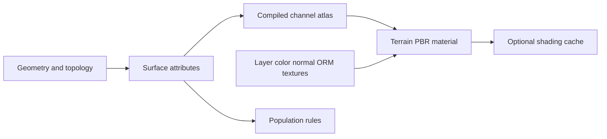

# Unreal Engine Mesh Terrain: Technical Research

Research date: 2026-11-06. Target: public UE 5.8 documentation and APIs.
Companion proposal: [Ada terrain composition design](../Designs/terrain-mesh-composition.md).
Status: research, not an implementation or a claim of feature parity.

## 1. Findings that change the Ada proposal

1. The public Unreal APIs describe editable **triangle meshes**, spatially bounded
   modifier operations, intermediate caches, and separate interactive output.
   Ada's existing heightfield plus scalar-density bricks is a different geometry
   strategy. Similar-looking caves do not make the two architectures equivalent.
   [Builder](https://dev.epicgames.com/documentation/unreal-engine/API/Plugins/MeshPartitionEditor/FMeshBuilder),
   [bounded mesh view](https://dev.epicgames.com/documentation/unreal-engine/API/Plugins/MeshPartitionEditor/FMeshView?lang=en-US).
2. A natural tree/ground intersection can involve geometric joining, terrain
   projection, material blending, and procedural population. Those mechanisms
   must be identified separately; a demonstration does not prove they all use
   a single automatic mesh-welding operation.
3. Epic exposes explicit cut-edge welding in its Boolean modifier. It also has
   different boundary-stitching and mesh-projection tools. There is no evidence
   here that Mesh Terrain is implemented as smooth-min SDF fusion.
   [Boolean API](https://dev.epicgames.com/documentation/unreal-engine/API/Plugins/MeshPartitionEditor/UBooleanModifier?lang=en-US).
4. Mesh Terrain's attribute-channel textures, the material's own texture sets,
   and Runtime Virtual Textures are three different resources. Confusing them
   hides requirements for caves, painting, and material transitions.
5. Population must sample actual geometry and attributes at an explicit stage.
   Ada's current heightfield anchors cannot represent a floor, ledge, wall, and
   ceiling independently at the same horizontal coordinates.
6. Interactive authoring and compiled gameplay content are separate concerns.
   PCG runtime generation does not establish runtime editing support for every
   Mesh Terrain modifier. Missing evidence must not become a product promise.

## 2. Method, confidence, and limits

Sources are primary: Epic documentation, generated API references, dated replies
by developers, official issue records, and original tutorial creators describing
their own work. Search results and third-party summaries were discovery leads,
not evidence of engine internals.

The full licensed Unreal source was not inspected, and Unreal was not launched.
Public declarations establish data types, documented responsibilities, and exposed
settings; they do not reveal complete algorithms, defaults, or synchronization.
Video metadata and published chapter descriptions were inspected where available;
the full recordings were not watched or transcribed. The introduction knowledge
base returned no readable article body. It remains a reading recommendation, not
a technical source silently treated as fully read.

Classification used throughout:

| Label | Meaning |
| --- | --- |
| Documented | Directly supported by a readable primary page or public API description |
| Dated statement | A developer's statement at a particular date; not a permanent guarantee |
| Inference | A conclusion from several public facts; exact implementation remains unknown |
| Ada proposal | Our own contract or architectural recommendation |
| Unverified | Requires a source checkout, playback, experiment, or platform execution |

Documentation can change after this date. All quoted status descriptions are
as-of this research. No roadmap date is used as a delivery commitment.

## 3. Reading and viewing guide

### 3.1 Start with the system and practical workflow

| Resource | Why it matters | Evidence inspected |
| --- | --- | --- |
| [Mesh Terrain overview](https://dev.epicgames.com/documentation/unreal-engine/mesh-terrain-in-unreal-engine) | Vocabulary and feature boundary | Article |
| [Crafting Mesh Terrain](https://dev.epicgames.com/documentation/unreal-engine/crafting-mesh-terrain-in-unreal-engine) | Create/convert, section editing, sculpt/paint, topology and Boolean workflows | Article |
| [Accessing Mesh Terrain](https://dev.epicgames.com/documentation/unreal-engine/accessing-mesh-terrain-in-unreal-engine) | Plugins, mode entry, modifier outliner, evaluation visibility | Article |
| [Mesh Partition Definition](https://dev.epicgames.com/documentation/unreal-engine/mesh-partition-definition-in-unreal-engine) | Reusable configuration and target outputs | Article |
| [Introduction to Mesh Terrain](https://dev.epicgames.com/community/learning/knowledge-base/nK7J/unreal-engine-introduction-to-mesh-terrain) | Original introduction by the feature team | Official link verified; body inaccessible |
| [A Practical Look at Mesh Terrain, Inside Unreal](https://www.youtube.com/watch?v=XlbWtoIk-Zc) | Official extended practical session | Metadata/chapter information; not full playback |
| [Epic's August learning roundup](https://www.unrealengine.com/learning/augusts-epic-learning-content-networked-physics-dynamic-audio-and-more) | Confirms the official session and its subject | Article |

The Inside Unreal chapter guide points to Landscape comparison around 08:03,
the modifier outliner around 19:02, texture/channel work around 21:33, remeshing
around 31:47, Booleans around 36:00, PCG around 41:02 and 48:44, runtime/partition
discussion around 1:00:32, collision/UVs/Nanite around 1:06:38, and performance/
caching around 1:18:27. Treat these as navigation aids, not claims extracted
from a fully reviewed transcript.

### 3.2 Material tutorials and original creator resources

| Resource | Relevant entry point | Limits |
| --- | --- | --- |
| [Unreal Sensei: Mesh Terrain tutorial](https://www.youtube.com/watch?v=Lhj2LutYNjA) | 23:36 master material; 39:12 painted layers; 52:47 mesh Boolean | Creator's tutorial description/chapters inspected; video not fully reviewed |
| [Sensei Terrain Material](https://www.unrealsensei.com/asset/senseiterrainmaterial) | Creator's resource page for the demonstrated material | No asset downloaded; shader graph and redistribution license not audited |
| [UE 5.8: How To Use Mesh Terrain, Unreal-X-Tutorials](https://www.youtube.com/watch?v=baDPUn994Hw) | Alternative walkthrough of modifiers and channel painting | Original creator's description; independent of Epic |
| [Mesh Terrain Material](https://dev.epicgames.com/documentation/unreal-engine/mesh-terrain-material-in-unreal-engine) | Official binding between channels and shading | Reference documentation |
| [Texturing Material Functions](https://dev.epicgames.com/documentation/unreal-engine/texturing-material-functions-in-unreal-engine) | Projection and height-biased blending techniques | General material tools, not mandatory Mesh Terrain internals |

The Sensei tutorial advertises auto texturing, triplanar projection, virtual
texture blending, and Nanite displacement. Its resource page describes automatic
slope-based layers. These are features of that creator's material/workflow;
they should not be reclassified as automatic behavior of every Mesh Terrain.
The supplied chapter list has a foliage timestamp inconsistent with its ordering;
this report intentionally does not reproduce that entry as a verified locator.

## 4. Representation and build architecture

### 4.1 Terminology

Epic distinguishes base sections, editor preview sections, and compiled runtime
sections. A definition asset configures construction. Weight channels are editable
surface attributes which are baked into a 2D texture array for compiled output;
modifiers affect geometry and/or channels. This channel array is not the same as
an array of grass/rock albedo textures.
[Overview](https://dev.epicgames.com/documentation/unreal-engine/mesh-terrain-in-unreal-engine).

The definition supplies channel schema, material, priority ordering, and separate
preview/build configurations. Platform variants choose transformer pipelines;
preview favors iteration and compiled output favors target rendering. Attribute
texel density is configurable. Only declared runtime channels become compiled
channel textures.
[Definition](https://dev.epicgames.com/documentation/unreal-engine/mesh-partition-definition-in-unreal-engine).

### 4.2 Triangle data and bounded modifications

`FDynamicMesh3` stores mutable triangle topology with edge adjacency and attribute
overlays. Many operators assume manifold input. UV/normal seams need not be
represented as a single value per geometric vertex.
[Dynamic mesh API](https://dev.epicgames.com/documentation/unreal-engine/API/Runtime/GeometryCore/FDynamicMesh3).

`FMeshData` exposes triangle base provenance, source UV channels passed through
modifiers, and separately generated channel-rendering UVs. `FMeshView` constrains
what a modifier can access by bounds, components, and requested channels, including
tracking triangles touching the boundary.
[Mesh data](https://dev.epicgames.com/documentation/unreal-engine/API/Plugins/MeshPartition/FMeshData?lang=en-US),
[mesh view](https://dev.epicgames.com/documentation/unreal-engine/API/Plugins/MeshPartitionEditor/FMeshView?lang=en-US).

Inference: a useful editable terrain abstraction includes topology, corner
attributes, provenance, and regional ownership. An array of positions/indices
prepared only for GPU drawing is not sufficient to provide that contract.

### 4.3 Evaluation, dependencies, and caches

`UModifierComponent` is documented as editor-only. Its public interface includes
dependency collection, code/cache versioning, priority, background preparation,
and distinct last-applied and last-submitted bounds. `FModifierGroup` holds ordered
descriptors, per-instance data, cache keys, and async-ready groups.
[Modifier](https://dev.epicgames.com/documentation/unreal-engine/API/Plugins/MeshPartitionEditor/UModifierComponent?lang=en-US),
[group](https://dev.epicgames.com/documentation/unreal-engine/API/Plugins/MeshPartitionEditor/FModifierGroup).

`FMeshBuilder` asynchronously produces a dynamic mesh and optional spatial tree;
it supports cancellation, local LRU caching, and optional derived-data-cache use.
`FModifierGraphCache` separately accounts for merged bases and cached modifier
views. The editor component exposes queues for changed bounds/modifiers and
distinct preview-build/transform contexts.
[Builder](https://dev.epicgames.com/documentation/unreal-engine/API/Plugins/MeshPartitionEditor/FMeshBuilder),
[graph cache](https://dev.epicgames.com/documentation/unreal-engine/API/Plugins/MeshPartitionEditor/FModifierGraphCache?lang=en-US),
[editor component](https://dev.epicgames.com/documentation/unreal-engine/API/Plugins/MeshPartitionEditor/UMeshPartitionEditorComponent?lang=en-US).

`FBaseGrowth` explicitly expands base influence for modifier grouping. This matters
when later effects act on geometry created outside the original base bounds.
[Base growth](https://dev.epicgames.com/documentation/unreal-engine/API/Plugins/MeshPartitionEditor/FBaseGrowth?lang=en-US).

Inference: prefix caching, batched regional invalidation, immutable worker inputs,
and stale-result rejection are suitable Ada design choices. The public API does
not disclose every cache boundary, task dependency, or eviction threshold.

### 4.4 Interaction is its own product

`AInteractiveSection` is a transient editor region expressly optimized for
interactive response. It contains base meshes, base/preview tasks, active
modifiers, and outdated-build state. A base filter can exclude later modifiers.
That is stronger evidence than assuming an ordinary final build becomes
interactive merely because it runs off-thread.
[Interactive section](https://dev.epicgames.com/documentation/unreal-engine/API/Plugins/MeshPartitionEditor/AInteractiveSection).

The user workflow requires a compiled-section build for gameplay/cooked output.
Large sections increase the scope of a local rebuild. Local remesh and tessellation
are authoring tools distinct from runtime LOD.
[Crafting](https://dev.epicgames.com/documentation/unreal-engine/crafting-mesh-terrain-in-unreal-engine).

## 5. What "the meshes grow together" can mean

| Mechanism | Geometry effect | Expected result | Typical failure if confused |
| --- | --- | --- | --- |
| Append/combine | Adds disconnected topology without intersection resolution | Several surfaces in one container | Interior overlap and visible intersection remain |
| Stitch/weld | Joins compatible boundary topology | Shared seam | Cannot resolve arbitrary intersecting solid interiors |
| Boolean union/subtract | Yes | Resolved local solid boundary | Thin/open foliage is not automatically a valid solid |
| Mesh projection/conform | Usually moves existing surface | Terrain follows a prop's shape | Prop and terrain can remain separate surfaces |
| Material transition/RVT | No | Similar color, roughness and normals at intersection | No new walkable surface or geometric connection |
| Procedural population | Changes placed-instance set | Grass/rocks adapt around the prop | Does not itself join terrain to the prop |

Stitch in Epic's tooling can join touching boundary edges. Boolean Union removes
overlapping interior surfaces; Subtract produces capped local boundaries; Trim
leaves an open hole. The Boolean API has explicit welding of newly cut edges,
seam-aware simplification settings, winding tests, channel transfer, and separate
operator/inclusion bounds.
[Crafting](https://dev.epicgames.com/documentation/unreal-engine/crafting-mesh-terrain-in-unreal-engine),
[Boolean modes](https://dev.epicgames.com/documentation/unreal-engine/API/Plugins/MeshPartitionEditor/UE__MeshPartition__EBooleanOpera-?lang=en-US),
[Boolean settings](https://dev.epicgames.com/documentation/unreal-engine/API/Plugins/MeshPartitionEditor/UBooleanModifier?lang=en-US).

`UMeshProjectModifier` provides directional projection, bounds, blend modes,
intersection smoothing, and channel writes. A tree can therefore appear embedded
through deformation and shading without welding every leaf and branch into the
terrain. This is a possible mechanism, not proof of which operation a particular
unreviewed demo used.
[Projection API](https://dev.epicgames.com/documentation/unreal-engine/API/Plugins/MeshPartitionEditor/UMeshProjectModifier?lang=en-US).

For Ada, the confirmed user requirement is stronger than color blending: at least
one explicit geometry-join path must produce a shared boundary that Wireframe and
collision can inspect. A closed root/base proxy is a practical participating
operand while the canopy remains independently rendered.

## 6. Local detail and output rendering

Remesh settings expose target edge length, channel-controlled density, smoothing,
projection back to the input, UV resampling, and boundary/seam constraints.
The local modifier currently documents an inclusion limitation: affected triangles
must have their vertices inside its influence box. This is a useful edge case for
Ada's own regional-selection tests, not a behavior to copy.
[Remesh base](https://dev.epicgames.com/documentation/unreal-engine/API/Plugins/MeshPartitionEditor/URemeshModifierBase?lang=en-US),
[local remesh](https://dev.epicgames.com/documentation/unreal-engine/API/Plugins/MeshPartitionEditor/URemeshModifier?lang=en-US).

The static-mesh transformer exposes LODs, skirts, streaming, optional Nanite and
fallback settings. Collision has its own transformer and simplification controls.
Consequently, Mesh Terrain is not synonymous with Nanite, and a coherent visual/
collision generation need not have identical triangle counts.
[Static output](https://dev.epicgames.com/documentation/unreal-engine/API/Plugins/MeshPartitionEditor/FStaticMeshTransformer?lang=en-US),
[collision output](https://dev.epicgames.com/documentation/unreal-engine/API/Plugins/MeshPartitionEditor/FCollisionTransformer?lang=en-US).

Ada must distinguish authoring edge length, scalar-volume cell size, channel texel
size, material repetition scale, and runtime screen-error LOD. A single generic
"resolution" slider would conceal important costs and failure modes.

## 7. Material architecture and breakdown

### 7.1 Four layers of data

This diagram is a conceptual decomposition for comparison, not a recovered Epic
render graph.

The official material nodes expose the channel resource, samples by name/index,
an inspector, and normalized/unit-space section coordinates. Channel values can
drive material-attribute blending. The page does not specify a default triplanar
shader, exact PBR mixing formula, or lossless imported-material merging.
[Material reference](https://dev.epicgames.com/documentation/unreal-engine/mesh-terrain-material-in-unreal-engine).

In a July 13 developer reply, Etienne Carrier described one automatically
unwrapped UV channel and UV editing/multiple channels as future work. The current
API separately exposes source-UV storage. These are different evidence levels:
data-structure capacity does not prove every UI workflow supports it. Exact
current import/Boolean UV behavior needs an experiment.
[Dated UV reply](https://forums.unrealengine.com/t/knowledge-base-introduction-to-mesh-terrain/2707493?page=3),
[source/channel UV fields](https://dev.epicgames.com/documentation/unreal-engine/API/Plugins/MeshPartition/FMeshData?lang=en-US).

### 7.2 Why a good material makes the demo look seamless

Our interpretation separates five effects:

- Geometry/normal continuity removes the visible crease or hole.
- A contact mask controls where soil changes into bark or rock.
- Material attributes mix in a common coordinate/normal convention.
- Projection handles stretched cliff/root UVs and cut faces.
- Small procedural detail distracts from repetition and reinforces contact.

For Ada these become explicit settings and testable shader behavior, not a promise
that importing any two materials can combine their arbitrary graph semantics.
World-aligned texturing and height-biased blends are available general techniques;
their coordinate choice affects moving-object texture stability.
[Texturing functions](https://dev.epicgames.com/documentation/unreal-engine/texturing-material-functions-in-unreal-engine).

### 7.3 Runtime Virtual Texturing: useful, but not geometry

RVT is a shading cache generated on demand. Writers and readers explicitly
participate. Epic documents an orthographic capture along the volume's negative Z
axis and recommends compatible world-space normal conventions for blending.
[RVT reference](https://dev.epicgames.com/documentation/unreal-engine/runtime-virtual-texturing-in-unreal-engine).

Mesh Terrain RVT setup requires assets, volumes, and an RVT transformer in both
preview and build pipelines. The quick start illustrates attribute sharing and
compositing with additional scene primitives.
[Mesh Terrain RVT setup](https://dev.epicgames.com/documentation/unreal-engine/runtime-virtual-textures-and-mesh-terrain-in-unreal-engine),
[RVT quick start](https://dev.epicgames.com/documentation/unreal-engine/runtimevirtual-texturing-quick-start-in-unreal-engine?application_version=5.8).

Inference: a single top-down cache cannot uniquely address every independent
floor/ceiling sheet sharing horizontal coordinates. It can accelerate appropriate
surface shading but should not be Ada's authoritative cave-paint storage. Geometry,
paint and placement must remain correct with the cache disabled or evicted.

## 8. Procedural filling after moving an object

Mesh Partition Query retrieves geometry and channels; ToPoint samples the surface.
Write preserves point count and original-position correspondence while allowing
destination positions to change.
Query/write priority boundaries are explicit to avoid feedback. Patch/mesh-projection
instance spawners can also create terrain modifiers.
[Mesh Terrain PCG integration](https://dev.epicgames.com/documentation/unreal-engine/pcg-and-mesh-terrain-in-unreal-engine).

PCG generation modes provide spatial partitioning, hierarchical coarse-to-fine
execution, and runtime cell generation/cleanup around sources. The generic World
Ray Hit Query instead samples the physics world; it must not be mistaken for
geometry-based surface input.
[Generation modes](https://dev.epicgames.com/documentation/unreal-engine/using-pcg-generation-modes-in-unreal-engine),
[node reference](https://dev.epicgames.com/documentation/unreal-engine/procedural-content-generation-framework-node-reference-in-unreal-engine).

UE 5.8's PCG release notes describe non-destructive manual edits, exclusions and
restoration. The GPU-processing documentation separately describes GPU-resident
procedural instances with persistence and feature limitations. These support
distinguishing saved authoring intent from optional ephemeral runtime scatter.
[5.8 release notes](https://dev.epicgames.com/documentation/unreal-engine/unreal-engine-5-8-release-notes),
[PCG GPU processing](https://dev.epicgames.com/documentation/unreal-engine/using-pcg-with-gpu-processing-in-unreal-engine).

Ada proposal: evaluate terrain, then authoritative surface channels, then generated
population, while keeping manual overrides separate. Use old/new object bounds,
spacing halos and deterministic cell ownership. Seeds alone do not preserve point
identity when triangle enumeration changes; identities need spatial/provenance
contracts independent of transient generated actors.

An official issue records painted foliage becoming invalid when editor terrain
sections are replaced and their identities differ from runtime sections. Another
records missing navigation output from the partition navigation builder. Both
were unresolved when inspected; target-fix fields are not promises.
[Foliage identity issue UE-398404](https://issues.unrealengine.com/issue/UE-398404),
[navigation issue UE-391361](https://issues.unrealengine.com/issue/UE-391361).

## 9. Ada source comparison

Repository inspected: `D:/Development/AdaEngine`, HEAD
`fc3aabbfd51679884836da1c71343675f9c8624e`, with substantial unrelated and
in-progress worktree changes. These observations concern the working files on
the research date, not a clean release or runtime certification.

| Area | Inspected implementation | Consequence |
| --- | --- | --- |
| Base terrain | `Terrain3DSource`, `TerrainHeightStorage` | Heightfield region/tile/LOD infrastructure is reusable |
| Volumes | `TerrainVolumeOperation`, `TerrainVolumeDocumentAsset`, `TerrainVolumeField` | Retained sampled union/subtract with one document cell size; no direct scene-entity binding |
| Extraction | `Math/Geometry/ScalarFieldSurface.swift` | Marching-tetrahedra surface extraction; not a triangle Boolean kernel |
| Operand validation | `ScalarMeshSolid.swift` | Closed/manifold solid validation; no arbitrary open-card union |
| Authoring | `EditorTerrainResourceWriter.swift` | Adds an operation with copied placement; moving the original entity is not a retained dependency |
| Materials | `TerrainMaterialPalette`, `TerrainLayerReference`, `TerrainMaterialResolver` | Stable IDs, bounded palette/rules, planar/triplanar options, top-four contributions |
| GPU material resources | `TerrainMaterialBindings`, `TerrainMaterialTextureArrays` | Existing layer arrays and per-surface ID/weight fields; extend rather than duplicate |
| Placement | `TerrainInstanceBrushKernel`, `TerrainPlacementAnchor` | Samples/reprojects the base heightfield, not arbitrary surface strata |
| Surface queries | `TerrainSurfaceQueries` | Revisioned actual triangle ray/closest queries already available |
| Instance persistence | `TerrainRegionInstance` | Authored rows exist; generated-rule ownership and override semantics need extension |
| Rendering | `DebugView3D`, `Main3DRenderNode`, `WGPURenderCommandEncoder` | Wireframe exists as a diagnostic enum, but WebGPU polygon-fill call is empty |
| Cluster rendering | `Mesh.Part`, `MeshletGeometry`, `MeshletLODGeometry`, ADR-0028 | Existing optional hierarchy is not Nanite or an editable topology kernel |

These are source observations. Tests were read selectively, but no engine/GPU
tests were run for this research. The active terrain task's fixes and performance
results must be verified in that task before reusing them as acceptance evidence.

## 10. Architecture options for Ada

| Strategy | Strengths | Main limitation for this request |
| --- | --- | --- |
| Extend heightfield + local density only | Reuses current caves, budgets and persistence | Does not provide direct triangle stitching, source-corner attributes, or local mesh remesh |
| New triangle-surface authoring backend | Fits imported mesh composition and local topology operations | Robust intersections, open patch boundaries and attribute transfer are substantial work |
| Separate static props + shading/population only | Cheap and useful for many environments | Cannot satisfy the explicitly requested genuine geometry-join path |
| Dense global scalar volume | Uniform 3D editing | Unnecessary memory/resolution cost for broad open terrain |

Recommendation: add a shared modifier/dependency/attribute framework and an explicit
triangle-surface backend for new Mesh Terrain assets, retaining the current hybrid
backend for compatibility and sampled solid tools. Do not pretend this backend is
already implemented or silently convert every old terrain. The companion design
defines proof gates before committing a production geometry kernel.

Original implementation candidates need separate evaluation. Manifold documents
solid-input Boolean processing and rejects invalid manifold input; it is not a
general open-terrain patch solution. CGAL documents richer surface/corefinement
facilities and package-specific licenses. Neither is selected or installed here.
[Manifold](https://github.com/elalish/manifold),
[CGAL polygon processing](https://doc.cgal.org/latest/Polygon_mesh_processing/index.html),
[CGAL package/license catalogue](https://doc.cgal.org/latest/Manual/packages.html).

## 11. Wireframe portability

WebGPU's standard primitive state exposes point, line and triangle topologies;
it does not provide Metal-style polygon line-fill state. Ada should use a portable
edge pass or a validated barycentric route, with actual LOD/deformation inputs.
Line topology has different culling/bias rules, so hidden-edge behavior needs an
explicit depth surface and shader/depth policy rather than a blind state copy.
[WebGPU primitive state](https://www.w3.org/TR/webgpu/#primitive-state).

## 12. What remains genuinely unknown

- Epic's complete Boolean/remesh algorithms, tolerance policy, threading, and
  worst-case behavior without inspecting the applicable licensed source.
- Current importer/material support for every source UV configuration, especially
  after Boolean/remesh and across editor/build paths.
- Exact channel texture formats, packing, atlas layout, gutters, filter policy,
  and which choices vary by build configuration.
- Whether a given filmed tree example uses projection, Boolean, RVT, a custom
  master material, PCG, PVE, or several together; the referenced clip was not supplied.
- Achieved interactive latency, runtime memory and frame costs on Ada's target
  hardware. No general UE performance claim is imported as an Ada benchmark.
- Gameplay-time availability of the full authoring modifier pipeline. Compiled
  consumption and PCG runtime generation are supported concepts; that stronger
  deformation claim is not established by this research. The documented
  `UModifierComponent` itself is explicitly editor-only; possible runtime
  equivalents or future variants were not established.

These limits do not prevent a concrete design. They prevent calling an Ada choice
an established Unreal internal or declaring parity without measured evidence.
